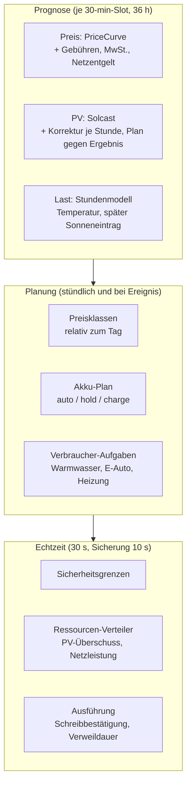

# Roadmap – Gesamtplan ab v3.8

!!! info "Status: Planung. Dies ist die einzige Roadmap"
    Grundlage ist der Code-Stand v3.7.2 (gegengeprüft am 2026-11-15). Die früheren
    Roadmap-Dokumente sind hier vollständig aufgegangen und gelöscht. Welche anderen
    EMS-Lösungen schon ausgewertet wurden, steht in
    [Abschnitt 11](#11-bereits-ausgewertete-losungen). Die Kennungen unter „Herkunft“
    (E2, W1, V4 …) sind dort erklärt.

    Die Herleitung bereits umgesetzter Funktionen steht in der technischen Referenz:
    [Energiefahrplan](../technical/energiefahrplan.md) (V1–V4, PV-Halt, gelernte
    Ladeleistung), [Geräteprofile](../technical/geraeteprofile.md) (Rollen,
    Auflösungskette, Schreibbestätigung) und
    [Netzladen-Entscheidung](../technical/netzladen-entscheidung.md).

    | Phase | Inhalt | Stand |
    |---|---|---|
    | **A** – Logik Akku und Netzladen | relative Preise, Entladesperre, SoC-bewusstes Gate, negative Preise, Tagesplan | **umgesetzt in v4.0.0** (A1–A11), alle Schalter aus; Simulation und Live-Freigabe je Baustein offen |
    | **B** – Mehrere Verbraucher | Sicherung, Ressourcen-Verteiler, E-Auto, Heizung | **umgesetzt in v4.1.0** (B1–B8), alle Schalter aus; Simulation und Live-Freigabe je Baustein offen, E-Auto mangels Wallbox nur in Simulation prüfbar |
    | **C** – Integration und GUI | Klartext, Bedienung aus HA, Plan-Ansicht, Plan-Treue, Ersparnis | **umgesetzt in v4.2.0** (C1–C7); offen: Profil-Erkennung für Solcast und Wärmepumpenzähler (C7) |
    | **D** – Geräteoffen (Ausblick) | Logik spricht mit Fähigkeiten statt mit Deye und Lambda | **D1 umgesetzt in v4.1.0**, D2–D4 offen |

    Am 2026-11-15 wurde der Plan auf Fehler und fehlende Pflichtfunktionen geprüft. Geändert
    wurden die Preisklassen-Formel, die Reihenfolge der Entladesperre und die Kaufwert-Rechnung.
    Neu sind A10 (Ausfallsicherheit), A11 (Pflegeläufe), die Einspeisegrenze in A5, §14a als
    Pflichtpunkt in B1 und der Ausblick in Abschnitt 7.

## 1. Ausgangslage (v3.7.2)

### Was schon da ist

| Bereich | Umgesetzt | Wo |
|---|---|---|
| Regelschleife | 30-s-Tick, fünf Modi, Verweildauer, Hysterese, Rückfall bei veralteten Daten | `ems_controller.py` (`_decide`, `_commit`) |
| PV-Halt (netzdienlich) | bis zur Solcast-Spitze, mit Abgleich gegen den Restbedarf (V3a, v2.6.2) | `_should_hold_pv_charge()` |
| Netzladen | Wirtschaftlichkeits-Gate (V4), Fensterwahl (V2), Ladeleistung strecken (V1) | `_should_grid_charge()`, `_grid_charge_power_w()` |
| Netzladen, Rückfallpfad | PV deckt zuerst das Haus: `PV-Rest ≥ (frei + Restverbrauch heute) × 1,2`, abends mit dem Verbrauch von morgen (v3.7.1). Restverbrauch = Tagesmedian minus heute gemessen | `_should_grid_charge()`, `ConsumptionModel.remaining_load_kwh()` |
| Überbrückungsplan | 30-min-Slots, 36 h, Last nach Temperatur, Solcast, Nowcasting | `bridge_planner.py`, `load_forecast.py` (v3.3.0) |
| Preise | Zeitfenster (Octopus `timeslots`) **und** Preisreihen (`rates[]`, Tibber `startsAt/total`, generisch) | `price_curve.py` (`tariff_source`) |
| Gelernte Ladeleistung | nach SoC-Bereich | `battery_capability.py` (v2.0.11) |
| Energiefahrplan | Anzeige von Defizit und Fenstern | `energy_plan.py` (v2.0.14) |
| Warmwasser | Datensammlung, Modell, gieriger Planer mit effektivem Preis inkl. Akku und COP, Steuerung (v3.4–v3.6). Seit v3.7.0: Mindest-Ladehub (3 K, bei laufendem Verdichter 1,5 K), Verdichterzustand aus `hw_compressor_entity`, „Jetzt“-Bonus nur bei echtem Engpass, Nachkaufpreis statt Einspeisevergütung, wenn vorher eine Netzladung geplant ist | `hot_water_*.py`, `battery_projection.py` |
| Geräteprofile | Erkennung, Rollen, Auflösung, Schreibbestätigung, Watt-Grenze | `device_*.py`, `write_channel.py`, `roles.yaml` |
| HA-Integration | 41 Sensoren, 7 Lovelace-Karten plus Tab-Kopf, generiertes Dashboard, Dienste | `integration/` |
| Diagnose | Warnband für fehlende und veraltete Sensoren, PV-Leistung nachts ausgenommen (v3.7.2, `sun.sun`) | `_build_sensor_warnings()` |

### Die wichtigsten Lücken

1. **Feste Preisschwelle.** `cheap_rate_threshold_eur` (Standard 0,10 €) entscheidet an fünf
   Stellen: `is_cheap_rate()` (Netzladen-Gate ohne Überbrückungsplan), `price_tier()` (Sensor),
   die kWh-Aufteilung nach Tarifstufe in der Kostenstatistik, die Plausibilitätsgrenze des
   historischen Entladetarifs und seit v3.7.0 das „nächste Niedrigpreisfenster“ im
   Warmwasser-Planer. Bei Preisreihen mit vielen Stufen trifft eine feste Schwelle an vielen
   Tagen daneben.
2. **Keine Entladesperre.** Im Modus `IDLE` entlädt der Akku auch bei billigem Strom. Am Abend,
   wenn es teuer wird, ist er dann leer (E2).
3. **Das Gate kennt den SoC nicht.** `_grid_charge_pays()` vergleicht mit einem historischen
   Entladetarif. Ob die teuren Stunden schon gedeckt sind, prüft es nicht (E3).
4. **Negative Preise werden nicht behandelt.** Der PV-Halt speist auch bei negativem Preis ein (E6/W1).
5. **Der Plan schaut nur auf das aktuelle Fenster.** Der Überbrückungsplan beantwortet
   „wie viel jetzt kaufen?“. Halten, Laden und Eigenverbrauch über die ganze Folge optimiert er nicht.
6. **Nur Akku und Warmwasser.** E-Auto und Heizung fehlen, ebenso eine Koordination mehrerer
   Verbraucher und ein Schutz der Hauptsicherung.
7. **Die Integration ist nur lesend.** Zur Laufzeit lässt sich nur über die Ingress-Oberfläche schalten.
8. **Auf Zeitfenster-Tarife zugeschnitten.** Börsenpreise (Day-Ahead) werden eingelesen, aber
   Überbrückungsplan, V1 und V2 nehmen lange Fenster mit genau gleichem Preis an. Dazu kommen
   zwei Fehler beim Einlesen reiner Börsenpreise. Solange miniEMS mit dem Octopus-Zeittarif
   läuft, betrifft das den Betrieb nicht (siehe A9).
9. **Kein Schutz bei einem Absturz.** Beim geordneten Beenden setzt miniEMS Wechselrichter und
   Warmwasser zurück (`restore_safe_defaults()`). Bei Absturz, `SIGKILL` oder Stromausfall des
   HA-Rechners bleibt der letzte Zustand stehen, zum Beispiel Netzladen an oder Entladestrom 0.
   Mit jeder neuen Stellgröße (Entladesperre, Wallbox, Vorlauf-Offset) wird das teurer (siehe A10).
10. **Vorgaben des Netzes fehlen.** Weder die Dimmung nach §14a EnWG noch eine Einspeisegrenze
    (60 % nach dem Solarspitzengesetz oder ein festes Limit am Wechselrichter) sind abgebildet.
11. **Teile der Logik sind an Deye und Lambda gebunden.** Wechselrichter und Akku laufen über
    Geräteprofile. Die Wärmepumpe hat keine Geräteklasse: Das Warmwasser schreibt fest über
    `lambda_heat_pumps.write_modbus_register` auf Register 2050 (siehe Abschnitt 7).

## 2. Leitlinien

Diese Regeln stammen aus den bisherigen Dokumenten und gelten für jeden Baustein.

1. **Die Regelschleife bleibt reaktiv.** Pläne werden neu gerechnet, wenn sich Preis, PV oder
   SoC ändern, und ausgeführt wird nur der aktuelle Slot. Ein Plan wird nie als Steuerquelle
   gespeichert und Stunden später unverändert abgespielt.
2. **Kein Solver, keine schweren Abhängigkeiten.** Kein MILP, kein genetischer Algorithmus,
   kein scikit-learn. Erlaubt sind reine Python-Funktionen, die auf einem Raspberry Pi in
   Sekundenbruchteilen laufen.
3. **Bei fehlenden Daten nichts tun.** Fehlt eine Zutat oder ist sie veraltet, gilt das
   bisherige Verhalten. Jeder Baustein hat einen eigenen Schalter mit Standard **aus**.
4. **Erst Simulation, dann live.** Neue Stellgrößen laufen zuerst nur mit `[SIM]`-Schreiben.
   Wo es möglich ist, gibt es vorher einen Rückblick-Test gegen die eigene Historie: Was hätte
   der Baustein gespart?
5. **Gelernt ist ein Rat.** Gelernte Werte gelten erst mit Mindestdaten, bleiben innerhalb
   physikalischer Grenzen und fallen sonst auf den Startwert zurück. In der Anzeige steht,
   ob ein Wert gelernt ist oder ein Startwert.
6. **Jede Entscheidung trägt einen Grund.** Jede Regel liefert einen Grund-Code und die Zahlen
   dazu (`ModeDecision.reason` plus Werte). Die Aufbereitung als Klartext kommt in Phase C,
   die Daten dafür entstehen schon in A und B.
7. **Sicherheit vor Wirtschaftlichkeit.** Harte Grenzen (SoC-Schutz, Sicherung,
   Übertemperatur) werden immer als Letztes angewendet und dürfen alles überschreiben.

## 3. Logikansatz (Zielbild)

### Drei Schichten



- **Prognose:** Was ist wann zu erwarten? Gibt es heute schon (`_build_plan_slots()`),
  wird um Korrekturen ergänzt.
- **Planung:** Was ist in welchem Slot sinnvoll? Liefert je Slot eine *Absicht*
  (Akku halten, laden, frei; E-Auto x kW; Wärmepumpe vorheizen).
- **Echtzeit:** Was darf jetzt tatsächlich passieren? Hier wirken die Messwerte, die
  Sicherung, die Überschussverteilung und die Schreibbestätigung. Diese Schicht korrigiert
  den Plan jeden Tick, denn dort liegt die Stärke von miniEMS.

### Feste Reihenfolge der Regeln

In EnergyWizard überschreiben in einer rund 1000 Zeilen langen Methode spätere Regeln die früheren.
Die Reihenfolge ist dort die Logik, und das ist fehleranfällig. miniEMS legt die Reihenfolge
**ausdrücklich** fest. Jede Stufe ist eine eigene, testbare Funktion:

| Rang | Regel | Beispiel |
|---|---|---|
| 1 | Daten veraltet → Steuerung an das Gerät zurückgeben | SoC ohne Lebenszeichen → `IDLE` (heute so) |
| 2 | Harte Grenzen | Akku unter Min-SoC, Sicherung überlastet, Warmwasser über Höchsttemperatur |
| 3 | Manuelle Übersteuerung mit Ablaufzeit | „Akku halten für 2 h“, „E-Auto jetzt laden“ |
| 4 | Pflicht-Fristen | E-Auto-Mindest-SoC am Morgen, Warmwasser-Komfort, Raumtemperatur-Untergrenze |
| 5 | Negative Preise | PV in den Akku, Netzladen ohne Gate, Wärmespeicher füllen |
| 6 | Planabsicht des Slots | Akku `hold` / `charge`, E-Auto-Fenster, Vorheizen |
| 7 | PV-Überschuss verteilen | Akku bis Prioritäts-SoC → E-Auto → Warmwasser → Rest-Akku → Export. Der netzdienliche PV-Halt (V3a, `EXPORT_SURPLUS`) bleibt hier als Regel: erst einspeisen, den Akku zur PV-Spitze laden |
| 8 | Rückfall | Eigenverbrauch (`IDLE`) |

Rang 2 wird **nach** allen anderen noch einmal angewendet, als Klemmung: Keine Regel darf
eine harte Grenze verletzen.

Rang 3 gibt es heute nur über die Ingress-Oberfläche. Die Bedienung aus HA kommt in C2. Für
das E-Auto reicht das nicht: „Jetzt laden“ muss mit der ersten Live-Schaltung da sein
(siehe B3).

### Kernformeln

**Relative Preisklassen** (Idee aus EnergyWizard, `nordpool.calculate_day_strategy`, `gpm.py`;
für Zeitfenster-Tarife angepasst):

```text
preise    = alle Slots des Kalendertags, zu dem der Slot gehört (auch die schon vergangenen)
spanne    = max(preise) − min(preise)
flach     = spanne < spanne_min                 → keine Optimierung, Eigenverbrauch
grenze    = Quantil(preise, günstige_stunden ÷ 24)
hysterese = clamp(0,15 × spanne, h_min, h_max)
low       ein bei preis ≤ grenze, aus erst bei preis > grenze + hysterese
high      preis ≥ Median + max(hysterese, 0,5 × (max − Median))
medium    sonst
```

Drei Punkte weichen bewusst von EnergyWizard ab. Sie sind am 2026-11-15 nachgerechnet:

- **Je Kalendertag statt „von jetzt bis zum Ende der Preisreihe“.** Um 22 Uhr sind nur noch
  zwei Stunden bekannt. Eine feste Anzahl günstiger Slots würde dann alles als günstig
  einstufen, und die Grenze würde im Tagesverlauf wandern.
- **Hysterese nur beim Verlassen.** EnergyWizard verlangt `preis ≤ grenze − hysterese`. Bei
  einem Stufentarif ist die Grenze der Niedrigpreis selbst, das Niedrigfenster wäre also nie
  günstig. Die Hysterese gilt außerdem nur für träge Stellglieder (Heizung). Die Gates für
  Akku und Warmwasser rechnen mit `preis ≤ grenze`.
- **`high` über den Abstand zum Median statt über P85.** HOCH dauert bei Octopus drei Stunden
  (18–21 Uhr), das sind 12,5 % des Tages. P85 liegt dann auf STANDARD, und es gäbe nie eine
  Spitze.

Mit Octopus (NIEDRIG 02–06 und 12–16, HOCH 18–21) ergibt die Rechnung low/medium/high wie
heute. Der Sensor `price_tier` behält seine drei Werte. Ein Test sichert das ab.

**Wert einer zusätzlich gekauften kWh** (E3 + E4, ersetzt den historischen Entladetarif):

```text
fenster = Slots bis zur Deadline mit preis > preis_jetzt
          Reihenfolge mit Entladesperre (A4): absteigend nach Preis
          Reihenfolge ohne Sperre: nach der Uhr, denn der Akku entlädt dann in jede Last
frei    = nutzbare_kwh(SoC) × η_entladen
          + PV-Überschuss, der vor dem jeweiligen Fenster noch in den Akku geht
für jedes fenster w:  bedarf_w = (last_w − pv_w)⁺
                      wenn frei ≥ bedarf_w: frei −= bedarf_w, weiter
                      sonst: w ist ungedeckt
lohnt_w = η × w.preis − preis_jetzt − verschleiß > min_marge
menge   = Σ ungedeckter Bedarf der Fenster mit lohnt_w, höchstens die freie Kapazität
alles gedeckt → nicht laden
```

Die erste kWh verdrängt die teuerste ungedeckte Stunde, jede weitere eine billigere. Der Wert
gespeicherter Energie ist also **konkav**: Eine Konstante führt entweder zum Horten oder zum
Leerfahren. Dieselbe Rechnung braucht die Entladesperre, deshalb gehört sie in eine Funktion.
Für das Halten gilt eine andere Schwelle als für das Kaufen: Gehaltene Energie ist schon im
Akku, ein zweiter Wirkungsgrad-Verlust fällt nicht an. Halten lohnt ab
`preis_später − preis_jetzt > δ`.

**Akku-Tagesplan** (aus EnergyWizard `battery_plan.optimize`, angepasst):

```text
Zustand  : Energie im Akku (200 Stufen, seit v4.2.2; zur Ausgangsstufe gerundet) × letzte Aktion
Aktionen : auto (Eigenverbrauch) | hold (nicht entladen, PV lädt) | charge (aus dem Netz)
           später optional: discharge (ins Netz), standardmäßig aus
Kosten   : Σ Netzbezug × Kaufpreis − Einspeisung × Vergütung
           + Verschleiß × entladene kWh
           + Wechselkosten je Aktionswechsel     (ruhiger Plan, weniger Schreibvorgänge)
           − Restwert am Ende = Energie × P25(Kaufpreis) × η   (sonst wird am Horizont leergefahren)
Grenzen  : Min-/Max-SoC, gelernte Lade- und Entladeleistung je SoC-Bereich, Netzladeleistung
           Einspeisegrenze: PV über der Grenze geht verloren, wenn der Akku voll ist. Der Plan
           hält dafür von selbst Platz frei. Das ersetzt im Planmodus den PV-Halt (V3a)
Rechnung : rückwärts über die Slots (dynamische Programmierung), 72 Slots × 100 × 3
Vergleich: gegen reinen Eigenverbrauch mit gleich bewertetem Endstand → „Plan spart x €“
```

Planungsstile (vorsichtig, ausgewogen, mutig) skalieren PV- und Lastprognose sowie den
Restwert-Perzentil. Das ist eine einfache, gut verständliche Risiko-Einstellung.

**Effektiver Preis für flexible Verbraucher** (heute schon im Warmwasser-Planer, wird
Standard für E-Auto und Heizung):

```text
PV-Anteil  : Einspeisevergütung, bei nicht vollem Akku max(Vergütung, Nachkaufpreis)
Netz-Anteil: Tarif, bei nutzbarem Akku min(Nachkaufpreis, Tarif)
Akku-kWh   : Einspeisevergütung, wenn später PV überläuft – aber Nachkaufpreis (Niedrigtarif ÷ η),
             wenn vorher eine Netzladung geplant ist (v3.7.0)
Wärme      : Strompreis ÷ COP(Vorlauf, Außentemperatur)        (Heizung, Warmwasser)
```

## 4. Phase A – Logik Akku und Netzladen

!!! success "Umgesetzt in v4.0.0"
    Alle Bausteine A1–A11 sind im Code, jeder mit eigenem Schalter (Standard aus, nur
    `failsafe_timeout_min` ist aktiv). Die Einstellungen stehen in
    [Konfiguration](../user/configuration.md#entscheidungslogik-v4-seit-v400). Offen ist die
    Freigabe nach Abschnitt 8: je Baustein eine bis zwei Wochen Simulation auf der Anlage,
    für A6 zusätzlich Schattenbetrieb mit Auswertung der geloggten Abweichungen.
    Abweichungen von der Beschreibung unten:

    - **A3:** Der günstige Lauf selbst wird aus dem Netz gedeckt, nicht aus dem Akku. Wer
      dort lädt, sperrt das Entladen (`GRID_CHARGING`), und mit Sperre gilt das ohnehin.
    - **A5 (4):** Die Einspeisebegrenzung folgt `battery_control_simulation`, eine eigene
      Simulationsstufe gibt es nicht.
    - **A6:** zusätzliche Aktion `export` (PV-Halt im Plan); berechnet alle 15 min und an
      jeder Slotgrenze in einem Thread.
    - **A7a:** Die gelernte Kapazität wird nur angezeigt, nicht verwendet.
    - **A10:** Die Integration hält die Rücksetz-Aufrufe nur im Speicher. Startet HA neu,
      während das Add-on ausgefallen ist, greift die Notabschaltung erst nach der nächsten
      gültigen Statusmeldung wieder.

Ziel: Netzladen bei niedrigen Kosten, und zwar nur dann, wenn sich das gegen die tatsächlich
ungedeckten teuren Stunden lohnt. Dazu soll der Akku nicht in billigen Stunden leerlaufen.

### A1 – Relative Preisklassen

**Herkunft:** EnergyWizard `nordpool.py`/`gpm.py`, Energiefahrplan V2.

- Neue reine Funktion `price_classes(curve, now) -> list[Klasse]` in `price_curve.py`,
  nach den Formeln oben.
- Umstellen, sobald eine Preisreihe vorliegt: `is_cheap_rate()`, `price_tier()` und das
  „nächste Niedrigpreisfenster“ im Warmwasser-Planer (`cheap_rate_eur`).
  `cheap_rate_threshold_eur` bleibt als Rückfall ohne Reihe.
- **Nicht** umstellen: die kWh-Aufteilung nach Tarifstufe in der Kostenstatistik und die
  Plausibilitätsgrenze des Entladetarifs. Die Statistik soll über Monate vergleichbar
  bleiben, und die Grenze entfällt mit A3 ohnehin.
- Config: `price_cheap_hours` (Standard 6), `price_hysteresis_min/max_eur`, `price_flat_spread_eur`.
- Der Sensor `price_tier` behält `low` / `medium` / `high`. Eine vierte Stufe gibt es nicht,
  damit vorhandene Automatisierungen und Karten weiterlaufen.

**Aufwand:** klein. **Risiko:** niedrig. Die Klassen beeinflussen nur Gates, die heute schon
existieren, und die Zeitfenster-Tarife ändern sich nicht.

### A2 – Lastprofil und Bedarf je Fenster

**Herkunft:** E1, v3.3 offen (6).

- `load_between(start, end)` als dünne Hülle um `LoadForecaster.predict_kwh()`. Das
  Stundenmodell nach Temperatur gibt es seit v3.3.0. Dazu `uncovered_windows(curve, soc,
  deadline)` als gemeinsame Funktion für A3, A4 und A6.
- Rückfallpfad von `_should_grid_charge()`:
    - ✅ Restverbrauch einbeziehen, heute und morgen (v3.7.1).
    - ✅ Den Faktor vorsichtig anwenden. Seit v3.7.1 muss die PV `1,2 × Bedarf` decken, vorher
      wurde die Prognose mit 1,2 *vergrößert*.
    - Offen: Der Restverbrauch ist ein Tagesmedian minus dem heute Gemessenen. Ersetzen durch
      `load_between(now, Deadline)`, sobald das Lastmodell bereit ist.
    - Offen: V2-Verschieben (`_should_defer_grid_charge()`) prüft nur Ladedauer und Fenster,
      nicht den Verbrauch bis zum späteren Fenster. Nur verschieben, wenn bis dahin kein
      nennenswerter Verbrauch aus dem Akku erwartet wird.

**Aufwand:** klein (der größere Teil des Rückfallpfads ist erledigt). **Risiko:** niedrig, es
ist reine Rechnung mit Tests.

### A3 – SoC-bewusstes Wirtschaftlichkeits-Gate und Verschleiß

**Herkunft:** E3, E4.

- `_grid_charge_pays()` rechnet nach der Kernformel „Wert einer zusätzlich gekauften kWh“.
  Fehlt das Lastmodell, gilt die heutige Prüfung.
- Entlade-Wirkungsgrad messen: nur Ticks mit Entladung und PV ≈ 0, 7-Tage-Mittel als Sensor
  (E4a). Er ersetzt im Gate `today_efficiency()`.
- Neues Feld `battery_wear_cost_eur_kwh`, Standard 0 (E4b). Die Einstellungsseite zeigt den
  Rechner dazu: Preis ÷ (Zyklen × nutzbare kWh).

**Aufwand:** klein bis mittel. **Risiko:** mittel. Ein zu strenges Gate lädt weniger, als es
könnte. Deshalb erst eine Woche Simulation mit Vergleich „alte gegen neue Gate-Entscheidung“
im Log.

### A4 – Entladesperre `HOLD`

**Herkunft:** E2, EnergyWizard `battery_control.py` Regel 9.

- Neuer Modus `EMSMode.HOLD_FOR_PEAK`: Entladestrom 0, PV-Laden erlaubt, kein Netzladen.
  Elektrisch ist das dasselbe wie `PROTECT_BATTERY`
  (`inverter_controller.py`, `apply_mode()`: Entladestrom 0 bei vollem Ladestrom). Dieses
  Verhalten des Deye ist im Betrieb also schon erprobt. Geräteoffen heißt die Fähigkeit
  „Entladen sperren“ (Abschnitt 7).
- Entscheidung in `_decide()` **nach** der Netzlade-Prüfung und vor `IDLE`: halten, wenn die
  nutzbare Energie nicht für die *teureren* ungedeckten Fenster bis zur Deadline reicht
  (`uncovered_windows` aus A2) und `preis_später − preis_jetzt > δ` gilt. Stünde die Sperre
  vor dem Netzladen, würde sie im günstigen Fenster jede Netzladung verdrängen, weil dort
  beide Bedingungen zugleich erfüllt sind. `GRID_CHARGING` sperrt das Entladen ohnehin.
- Schalter `discharge_hold_enabled`, Standard aus.

**Aufwand:** mittel. **Risiko:** mittel. Hält der Akku zu lange, kauft das Haus in
mittelteuren Stunden aus dem Netz. Gegenmittel: Hysterese, Mindestspanne δ und eine Woche
Simulation mit Auswertung „gehaltene kWh × (teurer Preis − Preis jetzt)“.

!!! note "Warum A4 vor dem Tagesplan (A6)?"
    A6 löst A4 und den Überbrückungsplan langfristig ab. A4 bringt den größten Einzelnutzen aber
    sofort, ist mit einer Regel erklärbar und liefert die Messdaten, an denen sich A6 messen
    lassen muss. Mit A6 wird A4 zum Rückfall.

### A5 – Negative Preise und Einspeisegrenze

**Herkunft:** W1, E6, EnergyWizard Prio 2 und „bezahlt für Bezug“.

1. Preis ≤ 0 oder Einspeisetarif-Sensor ≤ 0 → PV-Halt aufheben, PV in den Akku
   (Grund `negative price` bzw. `feed-in not remunerated`).
2. Netzladen bei Preis ≤ 0 ohne Wirtschaftlichkeits-Gate, aber mit Blick auf die PV, die
   später noch kommt. Sonst ist der Akku voll, wenn die Mittagsspitze negativ wird.
3. Akku voll und Preis ≤ 0 → Warmwasser bis `hw_max_temp_c`. Das ist ein neuer Auslöser für
   den vorhandenen Modus `HWMode.PV`, neben dem PV-Export-Auslöser.
4. Optional die Einspeisebegrenzung über die Rolle `inverter.grid_export_limit` auf 0 W, nur in
   Simulation, mit Rückstellung bei Shutdown und Übergabe.
5. Preis-Bausteine (E7): `price_is_spot`, `price_fee_eur_kwh`, `price_vat_pct`. Negative
   *Gesamt*kosten sind in Deutschland selten (Netzentgelt und Abgaben). Entscheidend ist meist
   die unvergütete Einspeisung nach dem Solarspitzengesetz. Die Gebühr darf je Zeitfenster
   verschieden sein. Das deckt die zeitvariablen Netzentgelte nach §14a Modul 3 ab.
6. **Einspeisegrenze:** neues Feld `feed_in_limit_w` (leer = keine Grenze). Neue Anlagen ohne
   Steuerbox dürfen nach dem Solarspitzengesetz nur 60 % der Modulleistung einspeisen. Liegt
   die PV-Prognose in einem Slot über Grenze plus Last, endet der PV-Halt rechtzeitig vorher,
   damit der Akku zur Spitze noch Platz hat. Derselbe Wert geht in den Tagesplan (A6) ein.

**Aufwand:** klein bis mittel. **Risiko:** niedrig für 1–3 und 6, mittel für 4 (neue Stellgröße).

### A6 – Akku-Tagesplan (dynamische Programmierung)

**Herkunft:** EnergyWizard `battery_plan.py`, E5, Energiefahrplan „Tagesbilanz“.

- Neues reines Modul `battery_plan.py` nach der Kernformel, Aktionen `auto | hold | charge`,
  30-min-Slots auf den vorhandenen Plan-Slots (`_build_plan_slots()`).
- Neu gerechnet wird stündlich, bei neuer Preisreihe, bei einer SoC-Abweichung von mehr als
  x % zum Plan und bei neuer Solcast-Prognose. Ausgeführt wird Slot 0, die
  Echtzeit-Schicht korrigiert.
- Die Netzladeleistung kommt aus dem Plan (Energie des Slots ÷ Slotdauer). Das ersetzt V1
  im Planmodus.
- Der Überbrückungsplan und A4 bleiben als Rückfall (`battery_plan_enabled`, Standard aus).
- Ausgabe: Aktion je Slot, SoC-Verlauf, geplante Kosten und Ersparnis gegen Eigenverbrauch.
  Das ist die Grundlage für die Plan-Ansicht in C3.
- Erst Schattenbetrieb: Plan rechnen, loggen und mit der tatsächlichen Entscheidung
  vergleichen. Danach Rückblick-Test über die Historie (`hourly_stats`, Preise).

**Aufwand:** groß. **Risiko:** mittel bis hoch. Prognosefehler wirken sich stärker aus als bei
Einzelregeln, und die Wechselkosten müssen kalibriert werden. Gegenmittel: Schattenbetrieb,
Planungsstil „vorsichtig“ als Standard, Neuberechnung bei Abweichung.

### A7 – Prognosegüte

**Herkunft:** W3, W4, W5, v3.3 offen (3).

- **A7a Akku-Kennwerte lernen** (W3): Wirkungsgrad, nutzbare Kapazität, Leistung aus Lade-
  und Entladeabschnitten, mit Grenzen und Mindestdaten.
- **A7b PV-Korrektur je Tagesstunde** (W4): Messung ÷ Prognose, begrenzt 0,3–2,0.
- **A7c Plan gegen Ergebnis** (W5): Slot-Prognose speichern, systematische Abweichung als
  Faktor (Last 0,8–1,25, PV 0,7–1,2).

**Aufwand:** je mittel. **Risiko:** niedrig, denn ohne genug Daten gilt der Startwert.
Die Bausteine machen A3, A4 und A6 belastbarer.

### A8 – Warmwasser: Kosten pro Start lernen

**Herkunft:** Beobachtung vom 14.11.2026, die zu v3.7.0 führte. An dem Tag gab es vier
Ladungen, zwei davon nur von 49,3 auf 50 °C. Nach jedem Start fiel der obere Fühler zuerst
um gut 1 K (kaltes Wasser aus den Leitungen), jedes Ladungsende hatte etwa 3 min Nachlauf, und
ein Start aus STBY löste 50 min Sperrzeit aus. Aus dem Heizbetrieb (CH → DHW) kam kein
zusätzlicher Start.

- Je abgeschlossener Ladung aufzeichnen (`heat_pump_recorder`):

    | Größe | Quelle |
    |---|---|
    | Wärme laut Lambda | Differenz des Zählers `hp1_hot_water_thermal_energy_*` über die Ladung |
    | Wärme im Boiler | ΔT × Volumen × 1,163 Wh/(l·K) |
    | Strom | Zähler `hp1_hot_water_energy_*` bzw. WP-Leistung |
    | Start aus | Verdichter lief (CH) oder stand (STBY) |
    | Knick | Minimum der Boiler-Temperatur nach dem Start − Starttemperatur |

- Lernen: fixe Verlustwärme pro Start = Wärme laut Lambda − Wärme im Boiler, getrennt nach
  „Start aus STBY“ und „Umschalten aus CH“, per Regression `Verlust ≈ fix + variabel × ΔT`.
  Ladungen mit Zapfung werden verworfen. Bei 2–4 Ladungen am Tag reichen vermutlich 2–3 Wochen.
- Ergebnis: fixe Verlustwärme pro Start. Im Planer wird jede Ladung mit
  `Verlustwärme × Preis ÷ COP` aufgeschlagen. Der feste Mindest-Ladehub
  (`hw_min_charge_k`) wird dann zur Untergrenze.
- Dasselbe Muster gilt später für die Heizung (B6/B7): Auch dort kostet jeder
  Verdichterstart etwas.

Den Verschleiß eines Verdichterstarts kann man nicht messen. Für „Start aus STBY“ bleibt
deshalb gegebenenfalls ein kleiner fester Aufschlag.

**Aufwand:** mittel. **Risiko:** niedrig, denn bis genug Ladungen gemessen sind, gilt der
feste Hub.

### A9 – Day-Ahead-Tauglichkeit (niedrige Priorität)

**Herkunft:** Quercheck vom 2026-11-15 gegen `price_curve.py`, `bridge_planner.py` und `ems_controller.py`.

**Warum niedrige Priorität:** Die Anlage läuft mit dem Octopus-Zeittarif, dort treten die
Schwächen nicht auf. A1, A3, A4 und A6 sind ohnehin so angelegt, dass sie mit beliebigen
Preisreihen funktionieren. A9 räumt die Stellen auf, die *heute* nur mit Zeitfenstern
richtig rechnen. Der Baustein wird fällig, sobald ein Börsentarif (Tibber, aWATTar,
Octopus Agile) genutzt oder miniEMS an andere weitergegeben wird.

**Einlesen** (`price_curve.py`):

- **Fehler – Einheit je Wert geraten:** Werte über 2 gelten als ct/kWh, jeder Wert für sich.
  Bei reinen Börsenpreisen in ct wird ein Mittagspreis von 1,5 ct zu 1,50 €/kWh und −3 ct
  zu −3 €/kWh. Die Einheit muss für die ganze Liste bestimmt werden, z. B. über den größten
  Betrag, oder kommt aus einem Config-Feld `price_unit`.
- **Fehler – Aufschläge fehlen:** Reine Börsenpreise kommen ohne Netzentgelt, Abgaben und
  MwSt. Kostenstatistik und Wirtschaftlichkeits-Gate rechnen dann falsch. Die Marge wird um
  etwa (1 − η) × Aufschläge überschätzt. Lösung: Preis-Bausteine nach A5 (5) bzw. E7.
- Formate ergänzen: getrennte Listen für heute und morgen (`raw_today`/`raw_tomorrow`) und der
  Zeitschlüssel `time`. Welche Integrationen welche Form liefern, muss gegen echte Entities
  geprüft werden.
- Warnband: `tariff_source = rates` (oder `auto` mit erwarteter Preisreihe) liefert keine
  Reihe → Hinweis statt stillem Rückfall auf die feste Schwelle.

**Rechnen:**

- **„Gleich günstig“ als Band:** `_RATE_TOLERANCE` (0,05 ct) im Überbrückungsplan und der
  Vergleich in `later_window_as_cheap()` werden zu einem Band, z. B. der Hysterese aus A1.
- **Kapazität späterer Fenster prüfen:** Ein späterer günstiger Abschnitt beendet die
  Überbrückung bzw. erlaubt das Verschieben (V2) nur, wenn Dauer × Ladeleistung die nötige
  Energie liefert. Sonst beendet eine einzelne günstige Viertelstunde die Planung, und es
  wird zu wenig geladen.
- **V1 Leistung strecken:** Gestreckt wird über die zusammenhängende Folge günstiger Slots
  (Preisklasse aus A1), nicht nur bis zum Ende des aktuellen 15-min-Slots.
- **Preis der Plan-Slots:** zeitgewichteter Mittelwert der Viertelstunden im 30-min-Slot
  statt nur des Preises zu Beginn (`_build_plan_slots()`).
- **Vergleichsbasis im Energiefahrplan:** Mittelwert der teuren Slots bis zur Frist statt des
  Preises genau zur Frist. Mittags ist der Börsenpreis oft am niedrigsten.
- **Horizont:** Die Preise für morgen kommen gegen 13 Uhr. Davor endet die Preisreihe um
  Mitternacht. Unbekannte Preise dürfen nicht als „Ende der Überbrückung“ gelten, ohne dass
  das im Plan sichtbar ist.

**Tests:** synthetische 15-min-Preisreihen mit Mittagsdelle, einzelnem günstigem Ausreißer,
negativen Preisen und Werten in ct, € und €/MWh. Mit Octopus-Zeitfenstern müssen alle
Entscheidungen identisch bleiben.

**Aufwand:** mittel (Einlesen klein, Rechnen mittel). **Risiko:** niedrig für die heutige
Anlage, weil der Zeitfenster-Pfad unverändert bleibt.

!!! note "Bis A9 umgesetzt ist"
    Neue Bausteine sollen keine weiteren Annahmen „lange Fenster mit gleichem Preis“
    einführen. Wo sie Fenster brauchen, nutzen sie die Preisklassen aus A1 und prüfen die
    Kapazität.

### A10 – Ausfallsicherheit: Wächter und Schreibbudget

**Herkunft:** Prüfung vom 2026-11-15 gegen `main.py` und `inverter_controller.py`.

- **Wächter in der HA-Integration.** Die Integration läuft im HA-Kern und damit unabhängig vom
  Add-on. Meldet das Add-on länger als x Minuten keinen Status, setzt sie die Stellgrößen auf
  die sicheren Werte: Netzladen aus, Lade- und Entladestrom auf Maximum, Warmwasser-Sollwert
  auf den Normalwert, später Wallbox und Vorlauf-Offset. Dazu kommt das Ereignis
  `miniems_alert`. Das ist die erste schreibende Funktion der Integration und bewusst die
  einzige vor C2.
- **Beim Start:** Der erste Tick schreibt alle Stellgrößen ausdrücklich. Das gilt heute für
  den Wechselrichter und muss für jede neue Stellgröße gelten.
- **Grenze:** Fällt HA selbst aus, schreibt niemand mehr. Deshalb darf miniEMS nur Zustände
  setzen, die auch über Stunden ungefährlich sind. Sie kosten dann Geld, schaden aber weder
  dem Gerät noch dem Komfort.
- **Schreibbudget je Kanal:** Zähler „Schreibvorgänge heute“ je Stellgröße als Diagnosewert,
  dazu eine Obergrenze pro Stunde. Die Verweildauer (`mode_dwell_sec`) begrenzt heute nur
  Moduswechsel. V1 und später A6 ändern die Ladeleistung öfter. Ob häufiges Schreiben dem
  Deye schadet, ist nicht belegt (siehe offene Fragen).

**Aufwand:** klein bis mittel. **Risiko:** niedrig. Der Wächter schreibt nur die Werte, die
das Add-on beim Beenden selbst schreibt. **Pflicht vor der Live-Schaltung von A4.**

### A11 – Pflegeläufe: Akku-Vollladung und Warmwasser-Hygiene

**Herkunft:** Prüfung vom 2026-11-15.

Beides sind wiederkehrende Pflichtaufgaben mit einer Frist (Rang 4). Der Zeitpunkt innerhalb
der Frist ist frei und wird in den günstigsten Slot gelegt.

- **Akku-Vollladung:** LFP-Akkus gleichen ihre Zellen nur nahe 100 % aus, und die SoC-Anzeige
  driftet ohne Vollladung. Entladesperre und Netzladen nach Bedarf halten den Akku im Winter
  lange im mittleren Bereich. Regel: Wurde `battery_max_soc` seit n Tagen nicht erreicht
  (Standard 14), wird einmal voll geladen, bevorzugt aus PV, sonst im günstigsten Fenster.
- **Warmwasser-Hygiene (optional, Standard aus):** einmal pro Woche auf eine einstellbare
  Temperatur. Für ein Einfamilienhaus mit 200-l-Speicher ist das keine Vorschrift. Vorher ist
  zu klären, ob die Lambda ein eigenes Programm fährt. Dann stimmt miniEMS nur den
  Zeitpunkt ab.

**Aufwand:** klein. **Risiko:** niedrig.

## 5. Phase B – Mehrere Verbraucher (E-Auto und Heizung)

!!! success "Umgesetzt in v4.1.0"
    B1–B8 und D1 sind im Code, jeder Baustein mit eigenem Schalter (Standard aus,
    E-Auto und Heizung zusätzlich mit eigener Simulation). Die Einstellungen stehen in
    [Konfiguration](../user/configuration.md#mehrere-verbraucher-seit-v410). Offen ist
    die Freigabe nach Abschnitt 8. Vorher zu klären: der Nennstrom der Hauptsicherung
    und die Phasenzuordnung der Netz-CTs (B1), eine Wallbox (B3–B5), ob die
    Lambda-Raumtemperatur repräsentativ ist (B7). Am 2026-11-15 per HA-MCP in der
    Anlage nachgesehen:

    - Phasenströme: die externen CTs des Deye (`sensor.deye8k_external_ct1..3_current`,
      ohne Vorzeichen), die Richtung kommt aus `sensor.deye8k_grid_l1..3_power`
      (+ = Bezug, Summe = `grid_power`). Beide sind die Standardwerte.
    - Keine Wallbox, kein Fahrzeug, kein Steuerbox-Signal (§14a) in HA.
    - Vorlauf-Offset `number.eu08l_hc1_flow_line_offset_temperature` (−10 … +10 K,
      Schritt 0,1) und Raumtemperatur `sensor.eu08l_hc1_room_device_temperature`
      sind vorhanden und vorbelegt.

    Abweichungen von der Beschreibung unten:

    - **B1:** Es gibt keinen Heizstab-Aktor, der Wächter wirkt auf Netzladen und
      Wallbox. Die Mindestleistung nach §14a bei mehreren Geräten wird nicht
      berechnet, sondern eingestellt (`grid_dimming_limit_w`). Der Deye hat eine eigene
      Peak-Shaving-Funktion (`number.deye8k_grid_peak_shaving`, Schalter aus), die als
      zweite, gerätenahe Grenze dienen kann.
    - **B2:** Der Echtzeit-Verteiler rechnet die Aufteilung nach Rang 7 und zeigt sie an
      (`surplus_share`). Das E-Auto regelt selbst nach Netzleistung, der Akku gibt seine
      PV-Ladung über den Prioritäts-SoC ab. Warmwasser behält seinen PV-Auslöser. Einen
      eigenen Modus „Akku pausiert“ gibt es nicht.
    - **B3:** kein Wallbox-Profil (Regel D4: erst mit einem echten Gerät). Die
      Anbindung läuft über Konfigurationsfelder, die den Rollen der Klasse `ev` folgen.
    - **B4:** Die Grundlast je Slot kommt aus dem vorhandenen Lastmodell, das schon
      nach Temperatur rechnet. Eigene Heizgradstunden gibt es nicht.
    - **B6:** Die Abstimmung mit dem Warmwasser läuft nur über den Verdichterzustand
      aus v3.7.0 (kleinerer Ladehub bei laufendem Verdichter).
    - **B7:** Der Rückblick prüft die Modellgüte (Vorhersagefehler je Stunde), nicht
      die Ersparnis in Euro. Dafür fehlen in der Historie die Preise und die
      Wärmepumpen-Energie je Stunde. Der Ersparnis-Nachweis bleibt dem Schattenbetrieb
      vorbehalten: Der Plan steht im Status, auch wenn er nicht entscheidet.
    - **D1:** Der Resolver bleibt Vorschau (`/devices` zeigt jetzt auch `heat_pump`).
      Die Lambda-Werte bleiben Standardwerte der Konfiguration, die Logik kennt nur
      die Fähigkeiten aus `heat_pump_device.py`.

Ziel: E-Auto und Heizung als gleichberechtigte Verbraucher, die sich PV-Überschuss,
Netzleistung und Akku-Energie nach festen Regeln teilen.

### B1 – Hauptsicherungs-Wächter

**Herkunft:** W2, EnergyWizard `fuse_guard.py`.

- Je Phase I² mit τ = 60 s tiefpassgefiltert. Drosseln über der Arbeitsgrenze, **sofort** bei
  einer Einzelmessung über 1,2 × Nennstrom. Nach dem Drosseln 20 s keine Erhöhung.
  Einspeisende Phasen werden nie gedrosselt.
- Veraltete Messwerte: vorsichtige feste Obergrenze aus gelernter Grundlast + Marge,
  **nie** „Hauslast = 0 A“.
- Wirkt auf Netzladestrom, E-Auto und Heizstab. Ohne Phasenströme sind B4 und B5 nicht live
  schaltbar.
- Phasenströme alle 10 s, solange ein steuerbarer großer Verbraucher läuft.
- **§14a EnWG – Pflicht, wenn die Anlage darunter fällt.** Das betrifft Wärmepumpe (mit
  Heizstab), Wallbox und Speicher mit Netzbezug über 4,2 kW, die ab 2024 in Betrieb gingen.
  Das Dimm-Signal der Steuerbox kommt als `binary_sensor`. Solange es anliegt, begrenzt
  miniEMS den Netzbezug der steuerbaren Geräte auf die zugesicherte Mindestleistung. Dazu
  zählt auch das Netzladen des Akkus, das heute mit bis zu 185 A läuft. Wie die
  Mindestleistung bei mehreren Geräten berechnet wird, ist vor der Umsetzung an der Festlegung
  der Bundesnetzagentur zu prüfen. Geräte mit eigenem Sperrkontakt (EVU-Kontakt der
  Wärmepumpe) regeln sich selbst. miniEMS muss das dann nur erkennen und im Plan
  berücksichtigen.

**Aufwand:** mittel. **Risiko:** niedrig, der Wächter reduziert nur. Wichtig ist die Prüfung
der Phasenzuordnung, die per Messung nachgewiesen werden muss.

### B2 – Ressourcen-Verteiler und Aufgaben

**Herkunft:** Energiefahrplan `ChargeTask` und Prioritätsschalter, EnergyWizard
`battery_control.py` Regeln 5–6, `gpm.py` Prio 3/4.

- `ChargeTask` wird zu `EnergyTask`: Gerät, Energiebedarf, Min/Max-Leistung, Frist,
  Art (`muss` / `flexibel`), Unterbrechbarkeit, Mindestlaufzeit.
- **Planung:** Die Aufgaben werden nach Frist sortiert und bedienen sich aus den Slots mit
  dem niedrigsten effektiven Preis. Der Akku-Plan (A6) sieht die geplanten E-Auto- und
  Heizleistungen als Last je Slot.
- **Echtzeit:** Der Verteiler gibt PV-Überschuss nach Rang 7 aus (siehe Tabelle oben).
  Die Netzleistung wird danach auf die Sicherungsreserve (B1) begrenzt.
- **Kopplungsregeln** aus dem Betrieb von EnergyWizard:
    - Der Akku entlädt **nicht** in das E-Auto, solange es aus dem Netz lädt
      (`ev_mode`: block / offload). Bei miniEMS deckt der Deye in `IDLE` jede Last, die hinter
      seinem Netz-Messwandler liegt.
    - Liegt der Akku über dem *Prioritäts-SoC*, pausiert er, und der Überschuss geht ans E-Auto.
    - Konkurrieren E-Auto und andere große Lasten um Netzstrom, bekommt die Aufgabe mit der
      knappsten Frist Vorrang.
- Prioritätsschalter `charge_priority` (Akku / E-Auto) zunächst nur als Config-Feld. Der
  HA-Schalter kommt in C2.

**Aufwand:** mittel. **Risiko:** mittel. Das ist ein Architekturschritt, der alle
Entscheidungen berührt. Gegenmittel: Mit nur dem Akku als Aufgabe müssen die Entscheidungen
identisch bleiben (Regressionstest).

### B3 – E-Auto: Anbindung (lesend, dann Simulation)

**Herkunft:** `roles.yaml` Klasse `ev`, EnergyWizard `drivers/charger.py`, `ev_power.py`.

- Wallbox-Schnittstelle analog zu `ChargerDriver`: `read_state`, `set_limit_a`, `set_phases`,
  `turn_on`, `turn_off`. Erstes Profil für die vorhandene Wallbox, über die
  Geräteprofil-Mechanik.
- Rollen: SoC (optional), Ladeleistung, gesteckt, Freigabe, Stromgrenze, Ziel-SoC, Abfahrt.
- Umrechnung kW ↔ A über `max_charge_kw / max_a` statt 230 V × Phasen. Sonst plant man bei
  einem Auto mit zweiphasigem Bordlader falsch.
- Ziel aus HA: `input_datetime` (fertig bis) und `input_number` (Ziel-SoC). Ein Wochenplan
  ist optional und erst in Phase C.
- Erkennung „Ladung hängt“ (Status wartet auf Start) mit `turn_on()`-Versuch.
- **Übersteuerung von Anfang an:** ein HA-Helfer `input_select` (Auto / Jetzt / Nur PV /
  Stopp), den das Add-on liest. Das braucht keine schreibende Integration und ist Bedingung
  für die Live-Schaltung von B4 und B5. C2 ersetzt den Helfer später durch eigene Entities
  mit Ablaufzeit.

**Aufwand:** mittel. **Risiko:** niedrig, solange nur gelesen und simuliert wird.

### B4 – E-Auto: Planung

**Herkunft:** EnergyWizard `decisions.py`, `ev_heating.py`.

- **Energiebedarf:** (Ziel − Ist) × Kapazität × **1,12** (Ladeverluste). Ist der SoC
  unbekannt, wird mit 20 % gerechnet, und das Auto stoppt selbst, wenn es voll ist.
- **Frist:** Bei 100 % Ziel eine Stunde früher. Das ist die Marge gegen Drosselung durch
  Sicherung oder Heizung.
- **Zwei Teilziele:** zuerst ein Mindest-SoC zur Morgenzeit (konfigurierbar, z. B. 50 % um
  06:00), dann der Rest bis zur Abfahrt.
- **Slot-Bewertung:** effektiver Preis plus ein Aufschlag für niedrige Ströme
  (`0,10 × (P_max / P_verfügbar − 1)`), weil das Laden mit 6 A einen schlechten Wirkungsgrad hat.
- **Leistung je Slot:** Hauptsicherung − vorhergesagte Grundlast. Die Grundlast wird **mit der
  Temperatur korrigiert** (k · Heizgradstunden), denn in kalten Nächten bleibt weniger für das
  Auto.
- **Zwei Durchläufe:** erst mit Reserve, dann „Pflicht“ ohne Reserve, aber nie über die Sicherung.

**Aufwand:** mittel. **Risiko:** mittel. Verpasst der Plan die Frist, ist das sofort sichtbar.
Gegenmittel: Teilziel am Morgen, Marge vor der Frist, Warnung „Ziel nicht erreichbar“.

### B5 – E-Auto: PV-Überschuss in Echtzeit

**Herkunft:** EnergyWizard `gpm.py` Prio 3.5.

- Start ab Überschuss ≥ Mindestleistung einphasig (≈ 1,4 kW), bei wechselhafter Sonne einphasig.
- Phasenumschaltung auf drei Phasen ab rechnerisch 18 A, zurück unter 5,5 A. Danach 15 min
  Sperre (Schütz-Schutz).
- Nachregeln alle 5 min. Kauft das Auto zu teurem Preis Netzstrom, jede Minute.
- Mindestlaufzeit 30 min nach dem Start. In der Sperrzeit wird mit 0 A pausiert, ohne die
  Sitzung zu beenden.
- PV-Überschuss hat Vorrang vor dem Netzplan. Die bereits so geladene Energie zählt auf die
  Aufgabe an.

**Aufwand:** mittel. **Risiko:** mittel. Häufiges Schalten verschleißt die Schütze. Gegenmittel:
Sperrzeiten und Mindestlaufzeit als Konstanten mit Tests.

### B6 – Heizung Stufe 1: Regeln über den Vorlauf-Offset

**Herkunft:** EnergyWizard `gpm.py` Prio 5/8, `no_sensor_heat`, `drivers/heatpump.py`; W7.

- Stellgröße: die Rolle „Vorlauf-Offset“ der neuen Geräteklasse Wärmepumpe (D1). Bei der
  Lambda ist das `number.*_hc1_flow_line_offset_temperature` (−10 … +10 K, HC-Register 50).
  Raum-Sollwert (Register 51) nur bei aktivem Raumthermostat.
- Preisklassen aus A1 → Offset: `low` +x K, `high` −y K, `medium` 0.
- **Nicht gegen die Lambda regeln:** Die Lambda-Integration kann selbst einen PV-Überschuss
  an die Wärmepumpe melden (Option `pv_surplus`, Register 102). Die Wärmepumpe hebt dann
  eigenständig an. Ist die Option aktiv, steuern zwei Regler dasselbe. Entweder bleibt sie
  aus, oder miniEMS liefert den Wert selbst und nutzt Register 102 als zweite Stellgröße
  „Überschuss melden“.
- **Heizstab-Schutz:** Nach einer Absenkung darf das Aufholen den Heizstab nicht auslösen,
  sonst ist die Ersparnis dahin. Liegt die Leistung der Wärmepumpe deutlich über der
  Verdichterleistung, gibt es eine Warnung, und die Absenkung wird für den Tag halbiert.
  Ob die Lambda den Heizstab-Betrieb meldet, ist offen.
- **Verdichterschutz:** nach jedem Wechsel 60 min (aufwärts) bzw. 45 min (abwärts) Sperre.
  Die Sperre übersteht einen Neustart. Ob der Verdichter läuft, liefert schon
  `hw_compressor_entity` (v3.7.0, Lambda-Verdichterleistung bzw. CH/DHW/CC/DEFROST).
- **Abstimmung mit dem Warmwasser:** Ein Vorheizen, das den Verdichter ohnehin startet, ist
  ein günstiger Zeitpunkt zum Umschalten auf Warmwasser (kleiner Ladehub, siehe v3.7.0).
  Umgekehrt darf eine Heizungsabsenkung keinen zusätzlichen Start für Warmwasser auslösen.
- **Schutz ohne Innenfühler:** höchstens 3 h am Stück abgesenkt, danach 1 h normal; unter
  −5 °C außen höchstens 1 K, unter −15 °C keine Absenkung. Kein Vorheizen im Sommer
  (Heizgrenze der Wärmepumpe).
- **Vorladen:** jetzt nicht `high` und in den nächsten 6 h ein `high`-Slot → +1 K. Ist für
  morgen Sonne gemeldet, gibt es weniger.
- **Bewertung mit COP:** Ein höherer Vorlauf senkt den COP. Vorheizen nur, wenn
  `preis_jetzt / COP_hoch < preis_spitze / COP_normal` gilt. EnergyWizard prüft das nicht.
- Der Offset wird beim Start, beim Shutdown und bei der Übergabe auf 0 gesetzt. Ein Absturz
  lässt die Wärmepumpe so nie verstellt zurück.

**Aufwand:** mittel. **Risiko:** mittel. Es geht um Komfort und Verdichter-Takten.
Gegenmittel: Simulation, kleine Offsets zu Beginn (±2 K), Sperrzeiten.

### B7 – Heizung Stufe 2: Raumtemperatur und Vorheizplaner

**Herkunft:** W6, W7, EnergyWizard Prio 5b und `mpc.py`.

- Innentemperatur erfassen, Heiz- und Auskühlphasen speichern. Lineare Raten:
  Auskühlen `a · (T_innen − T_außen) − b · PV_3h`, Aufheizen `c + d · T_außen`.
- Regelung nach Raumtemperatur: Ist das Haus warm und der Preis teuer, gibt es den kleinsten
  Offset. Liegt die Temperatur nahe der Untergrenze, wird angehoben.
  Ein Kältealarm gilt erst nach 30 min am Stück, nicht schon beim Lüften.
- Vorheizplaner (gierig wie beim Warmwasser): erste Verletzung des Komfortbands suchen,
  davor den günstigsten Slot (effektiver Preis ÷ COP) in den 6 h heizen, neu simulieren.
- **Erst Rückblick, dann live:** Der Planer wird gegen eine reaktive Basis auf der eigenen
  Historie nachgerechnet. Erst bei belegter Ersparnis wird gesteuert.

**Aufwand:** groß. **Risiko:** mittel bis hoch. Das Modell muss stimmen, sonst leidet der Komfort.

### B8 – Startempfehlung für flexible Geräte (optional)

**Herkunft:** E8.

Sensor `sensor.miniems_best_start_<gerät>` aus Preisreihe und PV-Prognose für konfigurierte
Geräte (kWh, Dauer). Er steuert nichts.

**Aufwand:** klein. **Risiko:** niedrig.

## 6. Phase C – Integration und GUI

!!! success "Umgesetzt in v4.2.0"
    C1–C7 sind im Code. Bis auf die Übersteuerung (C2) ändert keiner der Bausteine eine
    Entscheidung. Im lokalen Devcontainer gegen Home Assistant geprüft: neue Entities,
    Übersteuerung aus HA über `select.select_option`, Entitätsliste und Prüfung beim
    Speichern, alle Seiten. Beschreibung für Nutzer:
    [Dashboard](../user/dashboard.md#navigation), [Sensoren](../user/sensors.md),
    [Kosten](../user/costs.md#ersparnis-gegen-einen-haushalt-ohne-anlage-seit-v420).
    Abweichungen von der Beschreibung unten:

    - **C1:** Die Gründe des Warmwassers sind schon lesbare Sätze. Sie bekommen nur den
      Gerätenamen vorangestellt und werden nicht übersetzt.
    - **C2:** Eine Übersteuerung beginnt und endet sofort, ohne Verweildauer. Der Knopf
      „Übersteuerung beenden“ beendet alle Übersteuerungen; einzeln endet eine
      Übersteuerung über „Auto“ in der Auswahl.
    - **C3:** Die Plan-Ansicht ist eine neue Karte (`miniems-timeline-card`) und eine
      eigene Seite; die bisherige Plan-Karte bleibt daneben.
    - **C4:** Gezählt werden die Kanäle mit Zahlenwert (Lade-, Entlade- und
      Netzladestrom, Boiler-Sollwert, Wallbox-Strom, Vorlauf-Offset). Schalter
      (Netzladen, Wallbox-Freigabe) zählen noch nicht.
    - **C5:** Statt der offiziellen H25-Viertelstundentabelle nutzt miniEMS eine
      Näherung der Tagesform (austauschbar in `savings.py`). Stundenpreise werden erst
      seit v4.2.0 aufgezeichnet, die Ersparnis beginnt also mit dem ersten
      vollständigen Tag danach.
    - **C7:** Die Erkennung von Solcast-Sensoren und Wärmepumpenzähler über
      Geräteprofile fehlt noch. Die produktive HA war bei der Umsetzung nicht
      erreichbar, und ein Profil entsteht nur aus geprüften Registry-Daten (Regel D4).

Erst nach den funktionalen Änderungen, weil die Inhalte (Gründe, Pläne, Aufgaben) aus A und
B kommen. Die Reihenfolge innerhalb von C ist nach Nutzen gewählt.

### C1 – Entscheidung im Klartext

**Herkunft:** EnergyWizard Übersicht und `plan_brief.py`.

- Jeder Grund-Code (`ModeDecision.reason`, Warmwasser, E-Auto, Heizung) bekommt einen
  übersetzten Satz mit Zahlen, z. B. „Netzladen: 3,2 kWh bis 05:00, weil 18–21 Uhr 31 ct
  statt jetzt 18 ct“.
- Als Attribut `reason` an `sensor.miniems_mode`, als Banner oben im Dashboard und als eigene
  Zeile je Gerät.

**Aufwand:** klein. **Risiko:** niedrig.

### C2 – Bedienung aus HA, mit Rückfall auf Auto

**Herkunft:** Energiefahrplan „Prioritätsschalter“, EnergyWizard `timed_override.py`, `mqtt_bridge.py`.

- `PLATFORMS = ["sensor", "switch", "select", "number", "button"]`. Die Endpunkte bauen auf
  dem vorhandenen, leichten `/api/control_mode` auf (kein Neustart nötig).
- **switch:** Simulation, Akku-Steuerung, Warmwasser-, E-Auto- und Heizungssteuerung,
  Priorität Akku ↔ E-Auto.
- **select:** Übersteuerung je Gerät (Akku: Auto / Netzladen / Halten / Kein Netzladen;
  E-Auto: Auto / Jetzt / PV-only / Stopp), **immer mit Ablaufzeit** (15 min – 6 h, number).
  Danach fällt das Gerät auf Auto zurück.
- **button:** Warmwasser jetzt, Übersteuerung beenden.
- Konfliktregel GUI ↔ HA: Es gilt der zuletzt geschriebene Wert, beide Seiten zeigen
  denselben Zustand.

**Aufwand:** mittel. **Risiko:** mittel. Das ist eine neue Schreibrichtung in das Add-on.
Die Endpunkte brauchen dieselbe Validierung wie die Einstellungen.

### C3 – Plan-Ansicht und `next_action`

**Herkunft:** EnergyWizard Planuhr, Energiefahrplan „Dashboard“, v3.3 offen (4).

- Sensor `sensor.miniems_next_action`: ein Satz als Wert, Gerät/Start/Ende als Attribute.
  Damit gehen auch Benachrichtigungen und Sprachausgabe.
- Plan-Karte mit **einer** Zeitachse für Akku (Aktion und SoC-Verlauf), Netzladen,
  Warmwasser, E-Auto und Heizung, mit Preis und PV-Prognose im Hintergrund.
- Anzeige der Eingangsdaten je Plan: Preise bis …, PV aus Solcast oder Rückfall, Last aus
  Modell oder Lernphase.

**Aufwand:** mittel. **Risiko:** niedrig.

### C4 – Plan-Treue („Haben wir den Plan eingehalten?“)

**Herkunft:** EnergyWizard `control_journal.py`.

- Je Kanal und Minute Soll gegen Ist: Lade-/Entladeleistung, Wallbox-Strom, Vorlauf-Offset.
- Tagesquote und Abweichungszeiträume mit Erklärung, aufbauend auf `write_channel.py`.
  Im Simulationsmodus wird
  nichts gespeichert.

**Aufwand:** klein bis mittel. **Risiko:** niedrig.

### C5 – Ersparnis als Kopfwert

**Herkunft:** EnergyWizard `savings.py`, vorhandene Kostenszenarien.

- Eine Kachel „Ersparnis 7 Tage / Monat“. Basis ist der gleiche Verbrauch, verteilt nach dem
  **BDEW-Standardlastprofil H25** zum tatsächlichen Preis. Negative Tage werden als negativ gezeigt.
- Dazu die Plan-Ersparnis aus A6 („Plan spart heute x € gegen Eigenverbrauch“).

**Aufwand:** klein. **Risiko:** niedrig, sofern die Methode in [costs.md](../user/costs.md)
dokumentiert ist.

### C6 – Navigation und „Jetzt“-Seite

**Herkunft:** EnergyWizard App.

- Ingress-Hauptnavigation: **Jetzt / Plan / Geräte / Kosten**. Datenbank, Rohdateien und
  Log liegen unter **System**.
- Die Flow-Karte bekommt eine rechte Spalte mit Verbrauchern und Kurzstatus
  („Warmwasser 53 °C · nächste Ladung 13:00“, „E-Auto lädt nicht“).

**Aufwand:** mittel. **Risiko:** niedrig.

### C7 – Einrichtung und Diagnose

**Herkunft:** W8, v3.3 offen (1, 2, 5), Energiefahrplan offene Frage 7.

- Entity-Auswahl je Feld, gefiltert nach Domain und Einheit, mit Prüfung beim Speichern.
- Solcast-Sensoren und den Wärmepumpen-Zähler über Geräteprofile erkennen.
- Warnband: Planung ist aktiv, entscheidet aber nicht (Rückfall); V1 klemmt still.
- Ereignis `miniems_alert` für HA-Automatisierungen (Ziel nicht erreichbar, Schreibvorgang
  unbestätigt, Plan nicht umsetzbar).

**Aufwand:** mittel. **Risiko:** niedrig.

## 7. Ausblick: geräteoffen (Phase D)

Heute läuft miniEMS mit einem Deye-Hybridwechselrichter (über Solarman) und einer
Lambda-Wärmepumpe. Der Plan nennt diese Geräte dort, wo ihr Verhalten gemessen ist. Die Logik
selbst soll von ihnen nichts wissen.

### Grundsatz: Fähigkeiten statt Geräte

Die Planung rechnet in Watt, kWh und °C. Jeder Baustein nennt die Fähigkeiten, die er braucht.
Ein Geräteprofil legt fest, wie das Gerät eine Fähigkeit umsetzt. Fehlt eine Fähigkeit, bleibt
der Baustein aus und zeigt den Grund an (Leitlinie 3).

| Fähigkeit | Gebraucht von | Heute (Deye, Lambda) | Stand |
|---|---|---|---|
| Netzladen mit Leistungsvorgabe | Netzladen, A3, A6 | Rollen `grid_charge_enable` und `battery_charge_limit`, Umrechnung W ↔ A im Profil | geräteoffen |
| Entladen sperren | A4, B2 | Rolle `battery_discharge_limit` auf 0 | geräteoffen |
| Laden sperren | PV-Halt (V3a) | Rolle `battery_charge_limit` auf den Halte-Wert | geräteoffen |
| Einspeisung begrenzen | A5 (4) | Rolle `grid_export_limit`, noch ungenutzt | Rolle vorhanden |
| Phasenströme | B1 | Shelly 3EM oder Netz-CTs des Deye (offen) | Klasse `energy_meter` vorhanden |
| Warmwasser-Sollwert | Warmwasser | Lambda-Register 2050 über `hw_write_service` | **fest verdrahtet** |
| Verdichter-Zustand | A8, B6 | `hw_compressor_entity` | Config-Feld, keine Rolle |
| Vorlauf-Offset | B6 | Lambda HC-Register 50 | fehlt |
| Überschuss melden | B6 | Lambda-Register 102 | fehlt |
| Wallbox: Strom, Freigabe, Phasen | B3–B5 | noch keine Wallbox angebunden | Klasse `ev` vorhanden, kein Resolver |
| Schaltbare Last | B8, Heizstab | – | Klasse `load_actor` vorhanden, kein Resolver |

Andere Geräte setzen dieselbe Fähigkeit anders um, zum Beispiel über eine Betriebsart oder
eine Leistungsvorgabe statt über eine Stromgrenze. Das gehört in das Profil und nicht in
`ems_controller.py`.

### Bausteine

- **D1 – Wärmepumpe als Geräteklasse.** Neue Klasse `heat_pump` in `roles.yaml` mit den Rollen
  Warmwasser-Temperatur, Warmwasser-Sollwert, Vorlauf-Offset, Überschuss-Eingang,
  Verdichter-Zustand, Wärme- und Stromzähler. Die Lambda-Standardwerte aus `config_loader.py`
  (`hw_target_entity`, `hw_write_service`, `hw_write_data`, `hw_compressor_entity`) wandern in
  ein Profil `profiles/heat_pump/`. Geschrieben wird wie heute über eine Entity oder eine
  Dienst-Vorlage. D1 kommt **vor** B6, damit die Heizung gar nicht erst mit Lambda-Namen in
  der Logik entsteht.
- **D2 – Abstufung je Fähigkeit.** Jede Stellgröße hat eine Rückfallkette:
    - Heizung: Vorlauf-Offset → SG-Ready über zwei Schaltkontakte → nur Empfehlung als Sensor.
    - Wallbox: Strom und Phasen → nur Strom → nur an/aus. Mit „nur an/aus“ gibt es Laden im
      Preisfenster, aber kein Nachregeln auf PV-Überschuss.
    - Akku: Leistungsvorgabe → Stromgrenze → nur Netzladen an/aus.
- **D3 – Profil-Vertrag und Testgerät.** Jedes Profil nennt seine Fähigkeiten und Eigenheiten
  (`caveats`: Verzögerung der Rückmeldung, Schrittweite, Zähler-Überlauf). Ein simuliertes
  Profil mit allen Fähigkeiten dient den Tests, damit kein Logik-Test von Deye-Werten abhängt.
- **D4 – Weitere Profile nach Bedarf.** Ein Profil entsteht erst, wenn jemand das Gerät
  betreibt und die Schreibbestätigung im Betrieb nachweist. Einen Vorrat ungetesteter Profile
  gibt es nicht. Sinnvolle erste Kandidaten: ein SG-Ready-Profil als allgemeiner Rückfall für
  Wärmepumpen, und für Wallboxen [evcc](https://github.com/evcc-io/evcc) als Zwischenschicht,
  das viele Wallboxen und Fahrzeuge schon anbindet.

!!! note "Regel für die Phasen A und B"
    Neue Bausteine bringen keine neuen Deye- oder Lambda-Namen in die Logikmodule.
    Gerätespezifisches steht im Profil oder als Standardwert in der Konfiguration.

## 8. Umsetzungsplan

Aufwand: **S** bis 2 Tage, **M** bis 1 Woche, **L** mehr als 1 Woche (Entwicklung und Tests,
ohne Simulationszeit). Risiko bezieht sich auf Fehlentscheidungen im Live-Betrieb.

| Nr | Baustein | Herkunft | Aufwand | Risiko | Nutzen | Voraussetzung | Freigabe |
|---|---|---|---|---|---|---|---|
| 1 | **A1** Relative Preisklassen | EW, V2 | S | niedrig | hoch bei Preisreihen | – | sofort live, Vergleich im Log |
| 2 | **A2** Bedarf je Fenster, Rest des Rückfallpfads (Hausverbrauch ✅ v3.7.1) | E1, v3.3 (6) | S | niedrig | Freischalter | – | live |
| 3 | **A5** (1–3) Negative Preise | W1, E6 | S | niedrig | mittel, steigend | A1 | 1 Woche Simulation |
| 4 | **A3** SoC-bewusstes Gate, Verschleiß | E3, E4 | S–M | mittel | hoch | A2 | 1 Woche Simulation |
| 4a | **A10** Ausfallsicherheit (Wächter, Schreibbudget) | Prüfung | S–M | niedrig | **Pflicht** vor A4 live | – | Test: Add-on hart beenden |
| 5 | **A4** Entladesperre `HOLD_FOR_PEAK` | E2, EW | M | mittel | **sehr hoch** | A2, A3, A10 | 1–2 Wochen Simulation |
| 6 | **A7a** Akku-Kennwerte lernen | W3 | M | niedrig | mittel | – | Anzeige, dann im Gate |
| 7 | **A7b/c** PV-Korrektur, Plan gegen Ergebnis | W4, W5 | M | niedrig | mittel | A2 | Anzeige, dann im Plan |
| 8 | **A6** Akku-Tagesplan (DP) | EW, E5 | L | mittel–hoch | hoch | A1–A4, A7 | Schatten 2 Wochen + Rückblick |
| 9 | **A5** (4–6) Einspeisebegrenzung, Preis-Bausteine, Einspeisegrenze | W1, E7, Prüfung | S–M | mittel | gering bis mittel, hoch bei 60-%-Grenze | A5 (1–3) | Simulation |
| 9a | **A8** Warmwasser: Kosten pro Start lernen | Betrieb v3.7.0 | M | niedrig | mittel | ≥ 2–3 Wochen Ladungsdaten | Anzeige, dann im Planer |
| 9b | **A11** Pflegeläufe (Akku-Vollladung, Warmwasser-Hygiene) | Prüfung | S | niedrig | mittel | A4 | live, Hygiene Standard aus |
| 10 | **B1** Sicherungs-Wächter, §14a-Dimmung | W2, EW | M | niedrig | **Pflicht** für B | Phasenströme | live (nur drosselnd) |
| 11 | **B2** Ressourcen-Verteiler, `EnergyTask` | Energiefahrplan, EW | M | mittel | Freischalter | A6 oder A4 | Regressionstest: nur Akku = identisch |
| 12 | **B3** E-Auto Anbindung, Übersteuerung per HA-Helfer | roles.yaml, EW | M | niedrig | Freischalter | B2 | lesend, Simulation |
| 13 | **B4** E-Auto Planung | EW | M | mittel | hoch | B1–B3 | Simulation, dann live |
| 14 | **B5** E-Auto PV-Überschuss | EW | M | mittel | hoch im Sommer | B1–B3 | Simulation, dann live |
| 14a | **D1** Wärmepumpe als Geräteklasse | v3.0, Prüfung | M | niedrig | Freischalter für B6 und andere Geräte | – | Regression: Warmwasser identisch |
| 15 | **B6** Heizung Stufe 1 (Offset) | EW, W7 | M | mittel | mittel bis hoch | A1, B2, D1 | Simulation, kleine Offsets |
| 16 | **B7** Heizung Stufe 2 (Raum, Planer) | W6, W7, EW | L | mittel–hoch | hoch im Winter | B6, Innenfühler | Rückblick, dann live |
| 17 | **B8** Startempfehlung | E8 | S | niedrig | Komfort | A1 | live |
| 18 | **C1** Klartext-Gründe | EW | S | niedrig | hoch (Vertrauen) | A, B | live |
| 19 | **C2** Schalter/Auswahl mit Ablaufzeit | Energiefahrplan, EW | M | mittel | hoch | B2 | live |
| 20 | **C3** Plan-Ansicht, `next_action` | EW, v3.3 (4) | M | niedrig | hoch | A6, B4 | live |
| 21 | **C4** Plan-Treue | EW | S–M | niedrig | mittel | – | live |
| 22 | **C5** Ersparnis-Kachel (H25) | EW | S | niedrig | mittel | – (Plan-Ersparnis: A6) | live |
| 23 | **C6** Navigation, Jetzt-Seite | EW | M | niedrig | mittel | C1, C3 | live |
| 24 | **C7** Einrichtung, Diagnose, Ereignisse | W8, v3.3 (1, 2, 5) | M | niedrig | mittel | – | live |
| 25 | **A9** Day-Ahead-Tauglichkeit (Einlesen, Band statt Gleichheit, Kapazität, Slot-Mittel) | Quercheck | M | niedrig | gering heute, hoch mit Börsentarif | A1 | Tests mit Börsenpreisreihen, Zeitfenster identisch |
| 26 | **D2–D4** Abstufung, Testgerät, weitere Profile | v3.0, Prüfung | M je Gerät | niedrig | Reichweite über Deye und Lambda hinaus | D1 | je Profil Nachweis im Betrieb |

**Meilensteine:**

Die Versionsnummern unten stammen aus der Planung. Tatsächlich kam Phase A als v4.0.0,
Phase B (Nr. 10–17 mit 14a) als v4.1.0 und Phase C (Nr. 18–24) als v4.2.0.

- **v3.8 – Netzladen nach Bedarf:** Nr. 1–5 mit 4a. Danach lädt miniEMS nur noch, was die teuren
  Stunden wirklich brauchen, und hält es für diese zurück.
- **v3.9 – Prognosegüte und Tagesplan:** Nr. 6–9b.
- **v4.0 – Mehrere Verbraucher:** Nr. 10–14 (Sicherung, Verteiler, E-Auto).
- **v4.1 – Heizung:** Nr. 14a–17.
- **v4.2 – Integration und GUI:** Nr. 18–24.
- **Bei Bedarf – Day-Ahead:** Nr. 25. Niedrige Priorität, wird vorgezogen, sobald ein
  Börsentarif genutzt wird. Der Teil „Einlesen“ ist klein und kann jederzeit nebenher
  erledigt werden.
- **Ausblick – Geräteoffen:** Nr. 26. D1 ist fest eingeplant (v4.1), der Rest folgt mit dem
  ersten fremden Gerät.

## 9. Risiken und Gegenmittel

| Risiko | Betrifft | Gegenmittel |
|---|---|---|
| Akku wird zu lange gehalten, mittelteure Stunden kommen aus dem Netz | A4, A6 | Mindestspanne δ, Hysterese, Auswertung der gehaltenen kWh in der Simulation |
| Gate zu streng, günstige Fenster bleiben ungenutzt | A3 | Vergleich alte/neue Entscheidung im Log, Verschleiß standardmäßig 0 |
| Prognosefehler werden im Tagesplan verstärkt | A6 | Planungsstil „vorsichtig“, Neuberechnung bei Abweichung, A7 vorher |
| Der Plan springt zwischen Aktionen, viele Schreibvorgänge | A6, B6 | Wechselkosten im Plan, Verweildauer, Totband der Leistung |
| Überlastung der Hauptsicherung | B4, B5, Netzladen | B1 vor jeder Live-Schaltung von B, schnelle Abschaltung bei 1,2 × Nennstrom |
| Akku entlädt in das E-Auto | B2–B5 | Kopplungsregel „block/offload“ ist Bedingung für die Live-Freigabe |
| Schütz- und Verdichter-Verschleiß | B5, B6 | Sperrzeiten, Mindestlaufzeiten, Sperre übersteht Neustart |
| Komfortverlust bei der Heizung | B6, B7 | kleine Offsets, Grenzen bei Kälte, Untergrenze Raumtemperatur als Pflicht-Frist |
| Hängende Übersteuerung | C2 | jede Übersteuerung mit Ablaufzeit |
| Add-on stürzt mit aktiver Sperre oder Netzladung ab | A4, A5 (4), alle Stellgrößen aus B | A10: Wächter in der Integration, nur Zustände setzen, die über Stunden ungefährlich sind |
| Zwei Regler steuern die Wärmepumpe | B6 | Lambda-Option `pv_surplus` aus, oder miniEMS liefert den Wert |
| Heizstab holt die Absenkung teuer nach | B6, B7 | Heizstab-Schutz, Grenzen bei Kälte |
| Dimmung nach §14a wird übergangen | Netzladen, B4–B6 | B1, Dimm-Signal als harte Grenze (Rang 2) |
| PV wird an der Einspeisegrenze abgeregelt | PV-Halt, A6 | `feed_in_limit_w` in A5 (6) und im Tagesplan |
| Rechenzeit auf dem Raspberry Pi | A6 | 72 × 100 × 3 Zustände, Ziel < 1 s, Messung im Test |
| Börsenpreise werden falsch eingelesen (ct als €) oder zu wenig geladen | A9 | bis A9 nur Zeitfenster-Tarife empfehlen. Doku-Hinweis in `configuration.md` |

## 10. Verifikation

- **Je Baustein reine Funktionen mit Unit-Tests** (Muster `test_bridge_planner.py`,
  `test_hot_water_planner.py`), mit synthetischen Preisreihen: Octopus-Zeitfenster,
  Tibber-Stundenpreise, flacher Tag, negativer Mittag.
- **Abschaltbarkeit:** Alle neuen Schalter aus → Entscheidungen identisch zu v3.7.2
  (bestehende Tests bleiben unverändert grün).
- **A1:** Octopus-Tag → `low` genau in 02–06 und 12–16, `high` genau in 18–21. Abfrage um
  22 Uhr → nicht alles `low`. Flacher Tag → keine Optimierung.
- **A10:** Add-on-Prozess während `GRID_CHARGING` hart beenden → der Wächter setzt nach
  x Minuten zurück und meldet `miniems_alert`.
- **A4:** Wintertag ohne PV, SoC 50 %, Bedarf 6 kWh in HOCH → `HOLD_FOR_PEAK` bis 18:00,
  danach entladen. Gegenprobe SoC 95 % → keine Sperre.
- **A3:** gleicher Preis, SoC 20 % gegen 70 % → einmal laden, einmal nicht.
- **Überbrückungsplan (seit v3.3.0):** Backtest des Lastmodells gegen `hourly_stats`
  (Prognosefehler in kWh je Tag und je Fenster). Dazu einige Tage geplante Lademenge gegen
  den tatsächlichen Bedarf.
- **A6:** Plan nie teurer als Eigenverbrauch bei gleichem Endstand. Rückblick über
  ≥ 30 Tage Historie, geschätzte Ersparnis dokumentiert.
- **B1:** synthetische Phasenströme mit kurzer Spitze (kein Drosseln) und anhaltender
  Überlast (Drosseln), Einzelwert > 1,2 × Nennstrom (sofort).
- **B2:** nur der Akku als Aufgabe → identische Entscheidungen wie vorher.
- **B4:** Frist mit zu wenig Zeit → Warnung, Teilziel am Morgen erreicht.
- **D1:** Warmwasser über das Profil → dieselben Entscheidungen und Schreibvorgänge wie vorher.
- **Live:** jede neue Stellgröße mindestens eine Woche in Simulation auf der
  Produktivinstanz, Prüfung per HA-MCP, Auswertung im Event-Log.

## 11. Bereits ausgewertete Lösungen

Diese Liste verhindert doppelte Vergleiche. Vor einer neuen Auswertung bitte hier nachsehen.
Lohnt sich ein zweiter Blick, weil das Projekt sich weiterentwickelt hat, dann nur ab dem
angegebenen Stand.

| Lösung | Art | Ausgewertet (Stand) | Was gelesen wurde | Übernommen nach | Kennungen |
|---|---|---|---|---|---|
| [evcc-Optimizer](https://github.com/evcc-io/optimizer) | MILP-Optimierer als Dienst, MIT | 2026-08 | `optimizer.py` (Strafterm auf das Horizont-Maximum, zweistufige Lösung, Wert der gespeicherten Energie) | umgesetzt in v2.x: Ladeleistung strecken, Fensterwahl, PV-Halt, Wirtschaftlichkeits-Gate. Zweistufigkeit als Leitlinie | V1–V5 |
| [evcc](https://github.com/evcc-io/evcc) (Gerätetemplates) | Wallbox- und Geräte-Steuerung, MIT | 2026-08 | `templates/definition/{meter,charger,vehicle}`, `templates/README.md` | Geräteprofile: `caveats`, Prüfung durch Live-Lesen vor dem Speichern, Auswahlliste statt Freitext. Kandidat als Wallbox-Zwischenschicht (D4) | – |
| [SEM](https://github.com/traktore-org/sem-community) | HACS-Integration, Quality Scale Platinum | v1.7.5, 2026-08-20 (gegen miniEMS v2.0.4) | Architektur, Funktionsumfang, Batterie, Netzdienlichkeit, Kosten | Bestätigt die Richtung Geräteerkennung (v3.0). Vorbild für SG-Ready und Legionellenschutz (DVGW W 551), Vorzeichen-Erkennung mit Korrektur-Knopf | – |
| [Akkudoktor-EOS](https://github.com/Akkudoktor-EOS/EOS) | Genetischer Optimierer, steuert nicht selbst | `main` @ `fab3e17`, 2026-10-11 | `optimization/genetic/`, `devices/genetic/`, `prediction/`, `terminalvalue.py` | A2, A3, A4, A5, A6, B8 | E1–E8 |
| [EnergyWizard Open](https://github.com/murre87/energywizard) | Komplettsystem mit eigener App, AGPL-3.0 | `main`, 2026-11-03 | `learning.py`, `mpc.py`, `battery_learning.py`, `fuse_guard.py` | A5, A7, B1, B6, B7, C7 | W1–W8 |
| EnergyWizard Open, zweite Auswertung | wie oben | `main`, 2026-11-15 | `gpm.py`, `nordpool.py`, `battery_plan.py`, `battery_control.py`, `decisions.py`, `ev_power.py`, `ev_heating.py`, `drivers/`, App (`ewapp/`, `plan_brief.py`, `control_journal.py`, `savings.py`, `timed_override.py`) | A1, A4, A6, B1–B7, C1–C6 | – |

**Kennungen unter „Herkunft“:**

- **E1–E8** (EOS): E1 Lastprofil je Stunde, E2 Entladesperre, E3 SoC-bewusstes Gate,
  E4 Teillast-Wirkungsgrad und Verschleiß, E5 Bedarf statt freier Platz, E6 negative Preise,
  E7 Preis-Bausteine, E8 Startempfehlung.
- **W1–W8** (EnergyWizard, erste Auswertung): W1 negative Preise, W2 Sicherungs-Wächter,
  W3 Akku-Kennwerte lernen, W4 PV-Korrektur je Stunde, W5 Plan gegen Ergebnis,
  W6 Sonneneintrag lernen, W7 Hausmasse vorheizen, W8 Entity-Auswahl mit Prüfung beim Speichern.
- **V1–V5** (evcc-Optimizer, umgesetzt, Herleitung im
  [Energiefahrplan](../technical/energiefahrplan.md)): V1 Ladeleistung strecken,
  V2 Fensterwahl, V3/V3a PV-Halt bis zur Spitze, V4 Wirtschaftlichkeit, V5 Zweistufigkeit.
  „Energiefahrplan“ unter „Herkunft“ meint dessen nicht umgesetzte Teile (`ChargeTask`,
  Prioritätsschalter, Dashboard), die hier in B2, C2 und C3 stehen.
- **v3.3 (n):** offene Punkte der früheren Roadmap zur Bedarfsprognose (v3.3.0). Sie stehen
  jetzt in A2, A7, C3 und C7 sowie in der Verifikation.
- **EW:** zweite EnergyWizard-Auswertung. **Prüfung:** Fehlerprüfung dieses Plans vom
  2026-11-15. **Quercheck:** Abgleich mit dem Code v3.7.2.

**Nur erwähnt, nicht ausgewertet:** Victron VRM (als PV-Prognosequelle in EOS), Node-RED
(als Ausführungsschicht für EOS), Tibber, aWATTar und Nord Pool (nur als Preisquellen).

**Vor einem neuen Vergleich:**

1. In der Tabelle nachsehen, ob und mit welchem Stand die Lösung schon ausgewertet wurde.
2. Commit oder Version und Datum festhalten, die gelesenen Dateien nennen.
3. Lizenz prüfen. Bei AGPL oder GPL nur Ideen übernehmen, keinen Code.
4. Ergebnisse direkt als Bausteine in diesen Plan eintragen und eine Zeile in der Tabelle
   ergänzen. Ein eigenes Dokument entsteht nicht.

### Bewusst nicht übernommen

| Idee | Grund |
|---|---|
| MILP-Solver, genetischer Algorithmus | schwere Abhängigkeiten, nicht reproduzierbar, Rechenzeit (EOS ≈ 10 min auf dem Pi) |
| RandomForest, scikit-learn, `pickle` | Black Box, Abhängigkeit für Alpine/aarch64 |
| Eine große Regelmethode mit Reihenfolge als Logik (EW `gpm.py`) | fehleranfällig. Stattdessen feste Ränge und eigene Funktionen |
| Stundenbudget für die Leistung (schwedischer Leistungstarif) | gibt es für deutsche Haushalte nicht. Stattdessen §14a als harte Grenze |
| Akku-Entladung ins Netz (Arbitrage) als Standard | dünne Marge, Verschleiß. Höchstens später als Option in A6 |
| Eigene App (PWA), eigener Login | HA-App und Ingress genügen |
| Telemetrie | miniEMS sendet nichts nach außen |
| MQTT-Bridge | die eigene Integration mit eindeutigen IDs ist die bessere Lösung |

## 12. Offene Fragen

1. **A4:** Reicht `discharge_current = 0` beim Deye, oder deckt er bei PV-Überschuss trotzdem
   kurz aus dem Netz? `PROTECT_BATTERY` liefert die Messdaten dafür, die Auswertung fehlt noch.
2. **A1:** Wie viele günstige Stunden (`price_cheap_hours`) als Standard? Vorschlag 6,
   anhand der Octopus-Fenster (NIEDRIG 02–06 und 12–16 = 8 h) prüfen.
3. **A6:** Gemeinsame Funktion `uncovered_windows` für Gate, Sperre und Anzeige, damit sie
   nicht auseinanderlaufen? Vorschlag: ja, in `energy_plan.py`.
4. **B1:** Woher kommen die Phasenströme, vom Shelly 3EM am Netzanschluss oder von den
   Netz-CTs des Deye? Wie hoch ist der Nennstrom der Hauptsicherung? Teilweise
   beantwortet: Die Netz-CTs des Deye liefern Strom und Leistung je Phase (Standard in
   v4.1.0). Der Shelly 3EM misst nur die Wärmepumpe. Offen: Nennstrom und Phasenzuordnung.
5. **B3:** Welche Wallbox und Integration? Liefert das Auto einen SoC an HA? Sitzt die Wallbox
   hinter dem Netz-Messwandler des Deye? Davon hängt ab, ob „offload“ möglich ist oder nur „block“.
   Stand 2026-11-15: keine Wallbox in HA. v4.1.0 setzt „block“ als Standard.
6. **B6/B7:** Welcher Innenfühler ist repräsentativ? (Vorbelegt: Lambda HC1
   Raumtemperatur; ob sie das Haus abbildet, ist offen.) Wirkt der Vorlauf-Offset sofort oder
   erst nach der nächsten Neuberechnung der Heizkurve? Teilweise beantwortet: „Verdichter
   läuft“ und den Zustand CH/DHW liefert seit v3.7.0 `hw_compressor_entity`.
7. **C2:** Welche Seite gewinnt bei gleichzeitiger Änderung? Vorschlag: der zuletzt
   geschriebene Wert.
8. **A9:** Welche Börsenpreis-Integrationen sollen unterstützt werden (Tibber, Nord Pool,
   ENTSO-E, EPEX Spot, Octopus Agile)? Ihre Attributformen müssen an echten Entities
   abgelesen werden, nicht aus dem Quellcode der Integration übernommen.
9. **B1:** Fällt die Anlage unter §14a (Inbetriebnahme von Wärmepumpe, Wallbox oder Speicher
   ab 2024)? Welches Modul gilt? Gibt es eine Steuerbox, und ist ihr Signal in HA sichtbar?
   Stand 2026-11-15: kein Steuerbox-Signal in HA gefunden.
10. **A5:** Gilt für die PV-Anlage eine Einspeisegrenze (60 %, 70 % oder ein festes Limit am
    Wechselrichter)?
11. **B6/A11:** Ist die Lambda-Option `pv_surplus` aktiv? Meldet die Lambda den Heizstab-Betrieb?
    Gibt es einen Pufferspeicher? Fährt sie ein eigenes Legionellenprogramm?
12. **A10:** Vertragen die Einstell-Register des Deye häufiges Schreiben? In Foren wird vor
    Verschleiß des Speichers gewarnt, belegt ist das nicht. Bis zur Klärung gilt das
    Schreibbudget.

## 13. Betroffene Dateien (Überblick)

- **Phase A:** `price_curve.py`, `energy_plan.py`, `ems_controller.py`, `inverter_controller.py`,
  `const.py`, neu `battery_plan.py`, `battery_learning.py`, `load_forecast.py`, `solcast_client.py`,
  `store.py`, `config_loader.py`, `migration.py`, `hot_water_controller.py`,
  `integration/` (Wächter, A10).
- **Phase B (v4.1.0):** neu `fuse_guard.py`, `resources.py`, `energy_task.py` (aus
  `ChargeTask`), `ev_controller.py`, `ev_planner.py`, `ev_surplus.py`,
  `heating_controller.py`, `heating_model.py`, `best_start.py`, `phase_b.py` (Verdrahtung
  in `EMSController`); `roles.yaml`, `store.py`, `integration/sensor.py`.
- **Phase C (v4.2.0):** neu `reason_text.py`, `overrides.py`, `timeline.py`,
  `plan_fidelity.py`, `savings.py`, `ha_entities.py`, `phase_c.py`; `integration/`
  (`control.py`, `switch.py`, `select.py`, `number.py`, `button.py`, `sensor.py`,
  `miniems-timeline-card.js`, Flow-Karte), `web_server.py`, `templates/` (`_nav.html`,
  `plan.html`, `consumers.html`, `costs.html`, `system.html`), `static/pages.js`,
  `translations/`.
- **Phase D (D1 in v4.1.0):** `roles.yaml` (Klasse `heat_pump`), neu
  `profiles/heat_pump/lambda_eu08l.yaml`, `heat_pump_device.py`, `hot_water_controller.py`,
  `legacy_entity_fields.py`, `web_server.py` (`/devices`).
- **Doku:** `docs/technical/netzladen-entscheidung.md`, `calculations.md`,
  `docs/user/configuration.md`, `costs.md`, DE und EN. Von `netzladen-entscheidung.md`,
  `energiefahrplan.md` und `geraeteprofile.md` gibt es noch keine englische Fassung.
