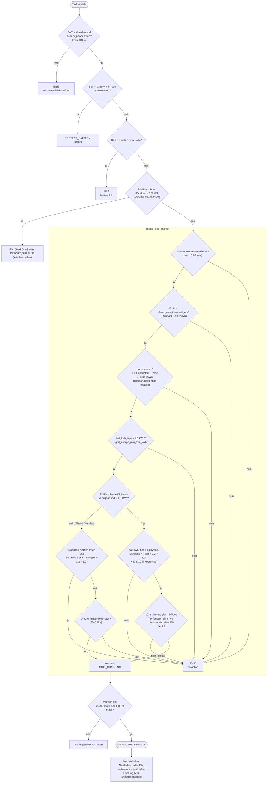
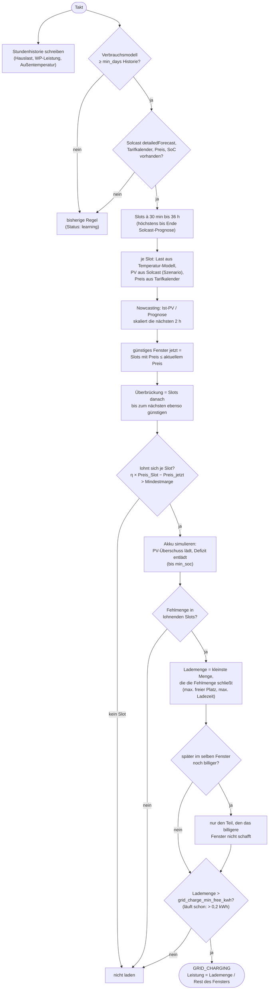

# Netzladen: Wie miniEMS entscheidet

Diese Seite beschreibt, wann die App den Speicher aus dem Netz lädt
(Modus `GRID_CHARGING`). Die Logik liegt in
`miniems/rootfs/usr/bin/ems_controller.py`, die Umsetzung am Wechselrichter
in `inverter_controller.py`.

Grundprinzip: **Jede fehlende oder veraltete Eingabe führt zu „nicht laden“**
(fail closed). Einzige bewusste Ausnahme ist die Wirtschaftlichkeitsprüfung,
die bei fehlender Historie übersprungen wird (siehe Schritt 7).

Seit v3.3.0 gibt es zwei Verfahren:

- **Überbrückungsplanung** (`load_forecast_enabled: true`, genug Historie):
  rechnet in 30-Minuten-Schritten, wie viel geladen werden muss, um das
  nächste teure Tarif-Fenster zu überbrücken. Siehe
  [unten](#uberbruckungsplanung-ab-v330).
- **Bisherige Regel** (Standard, und Rückfall bei fehlenden Eingaben):
  der folgende Ablauf.

## Ablauf pro Takt

`EMSController.update()` liest die Sensoren, rechnet den freien Speicher
(`bat_kwh_free`) aus und ruft `_decide()` auf. Die Prüfungen laufen in fester
Reihenfolge; die erste, die greift, bestimmt den Modus.

## Die Bedingungen im Einzelnen

| # | Prüfung | Code | Standardwert |
|---|---|---|---|
| 1 | SoC lesbar, `battery_power_entity` nicht eingefroren | `_decide()` | `sensor_max_age_sec` = 300 s |
| 2 | Kein Batterieschutz aktiv | `_decide()` | `battery_min_soc` = 15 % |
| 3 | Speicher nicht voll | `_decide()` | `battery_max_soc` = 95 % |
| 4 | Kein PV-Überschuss (sonst hat PV-Laden Vorrang) | `_decide()` | `pv_surplus_threshold_w` = 200 W |
| 5 | Preis vorhanden und nicht veraltet | `_should_grid_charge()` | `price_max_age_sec` = 21 720 s |
| 6 | Preis unter Billig-Schwelle | `CostOptimizer.is_cheap_rate()` | `cheap_rate_threshold_eur` = 0,10 €/kWh |
| 7 | Netzladen lohnt sich: `η × Entladetarif − Preis > Marge` | `_grid_charge_pays()` | `grid_charge_min_margin_eur_kwh` = 0,02 €/kWh |
| 8 | Genug Platz im Speicher | `_should_grid_charge()` | `grid_charge_min_free_kwh` = 1,0 kWh |
| 9 | PV schafft es heute nicht selbst (mit Hysterese) | `_should_grid_charge()` | `pv_charge_margin_factor` = 1,2, `pv_charge_hysteresis_frac` = 0,10 |
| 10 | Kein gleich billiges späteres Fenster (V2) | `_should_defer_grid_charge()`, `PriceCurve.later_window_as_cheap()` | – |
| 11 | Wunsch stabil über Verweilzeit | `_commit()` | `mode_dwell_sec` = 300 s |

### Zu Schritt 7 (Wirtschaftlichkeit)

Wirkungsgrad `η` und durchschnittlicher Entladetarif stammen aus der
gespeicherten Historie. Fehlt einer der beiden Werte (frische Installation),
wird die Prüfung **übersprungen** statt blockiert – sonst könnte eine neue
Installation wochenlang gar nicht netzladen.

### Zu Schritt 9 (PV-Prognose)

- **Heutige Rest-Prognose vorhanden:** Netzladen nur, wenn der freie Speicher
  größer ist als `Rest × 1,2 + 1,0 kWh`. Die Schwelle ist asymmetrisch:
  Einsteigen erfordert +10 %, ein laufendes Netzladen bricht erst bei −10 %
  ab. So pendelt der Modus nicht.
- **Keine nutzbare Rest-Prognose** (abends ≈ 0, oder Sensor/Solcast-Daten
  veraltet):
  1. Reicht laut frischer Prognose für morgen die PV, den Speicher zu füllen
     (`bat_kwh_free <= morgen × 1,2 + 1,0`), wird **nicht** geladen.
  2. Sonst wird nur im Dunkelfenster geladen
     (`grid_charge_dark_start_hour` 21 Uhr bis `grid_charge_dark_end_hour` 6 Uhr).
- Solcast-Daten gelten als veraltet, wenn der letzte Abruf älter als 30 h ist
  (`SOLCAST_DATA_MAX_AGE_SEC`). Die Prognose für morgen wird nach Datum
  geprüft, nicht nach Alter.

### Zu Schritt 10 (V2: Laden verschieben)

Gibt es nach dem aktuellen Tariffenster noch ein Fenster mit gleichem oder
niedrigerem Preis, und reicht die Zeit dort noch, um bis zum nächsten
PV-Peak (Solcast heute/morgen) voll zu werden, wird verschoben. Typischer
Fall: Niedertarif 12–16 Uhr an einem mäßigen PV-Tag, während 02–06 Uhr
genauso billig ist. Ist etwas unklar (kein Tarifkalender, kein Peak-Zeitpunkt,
keine Ladeleistung bekannt), wird **nicht** verschoben.

Die benötigte Ladedauer ist `bat_kwh_free / Ladeleistung`. Die Ladeleistung
kommt aus der gelernten, nach SoC gestaffelten Historie, sonst aus
`battery_max_charge_current_a × Batteriespannung`.

## Überbrückungsplanung (ab v3.3.0)

Aktiv, wenn `load_forecast_enabled` an ist, mindestens
`load_forecast_min_days` Tage Stundenhistorie vorliegen und alle Eingaben
da sind. Code: `bridge_planner.py`, `load_forecast.py`,
`EMSController._update_bridge_plan()`.

### Verbrauchsmodell

Je Stunde: `Last(h, T) = Grundlast[h] + WP_pauschal + k × max(0, Heizgrenze − T)`

| Größe | Herkunft |
|---|---|
| `Grundlast[h]` | Median je Tagesstunde. Mit WP-Zähler: Hauslast ohne WP. |
| `WP_pauschal` | Mit WP-Zähler: fester Anteil (Warmwasser, Standby) aus der Regression. Ohne: 0, steckt in der Grundlast. |
| `k` | kWh je Stunde und Kelvin unter der Heizgrenze. Regression mit eigenem Grundwert je Tagesstunde, damit Tagesrhythmus und Temperatur sich nicht vermischen. |
| `T` | Stundenprognose der `weather_entity`; fehlt sie, mittlere Heizgradzahl der Historie. |

Eine Stunde zählt nur, wenn mindestens 75 % von ihr gemessen wurden; ein Tag
zählt für `load_forecast_min_days`, wenn mindestens 18 Stunden vollständig
sind. Neu angepasst wird höchstens einmal pro Stunde, Rückblick 60 Tage.

### Beispiel Octopus Heat

NIEDRIG 02–06 und 12–16 Uhr, sonst STANDARD:

- **02:00:** Überbrückung = 06–12 Uhr. Geladen wird, was der Akku plus
  Vormittags-PV für den Vormittagsverbrauch nicht schafft.
- **12:00:** Überbrückung = 16–02 Uhr. Am Wintertag mit wenig Sonne und hoher
  Wärmepumpenlast entsprechend viel, im Sommer meist nichts.

## Was im Modus GRID_CHARGING passiert

`InverterController.apply_mode()`:

1. Netzladeschalter (`grid_charge_switch_entity`) wird eingeschaltet.
2. Ladestrom: Leistung gestreckt auf das restliche Tariffenster (V1,
   `_grid_charge_power_w()`): `bat_kwh_free / (Restdauer × 0,8)`, mit
   Überbrückungsplanung `Lademenge / (Restdauer × 0,8)`. Ohne
   Tarifkalender gilt der konfigurierte Maximalstrom.
3. Entladen wird gesperrt, damit die gekaufte Energie nicht sofort wieder
   verbraucht wird.

Ist `battery_control_enabled` aus, wird nichts geschrieben; im
Simulationsmodus wird nur geloggt.

## Nicht entscheidungsrelevant

Der **Energiefahrplan** (`energy_plan.py`, `_update_energy_plan()`) rechnet
eine Tagesbilanz für das Dashboard, beeinflusst die Ladeentscheidung aber
**nicht**.
