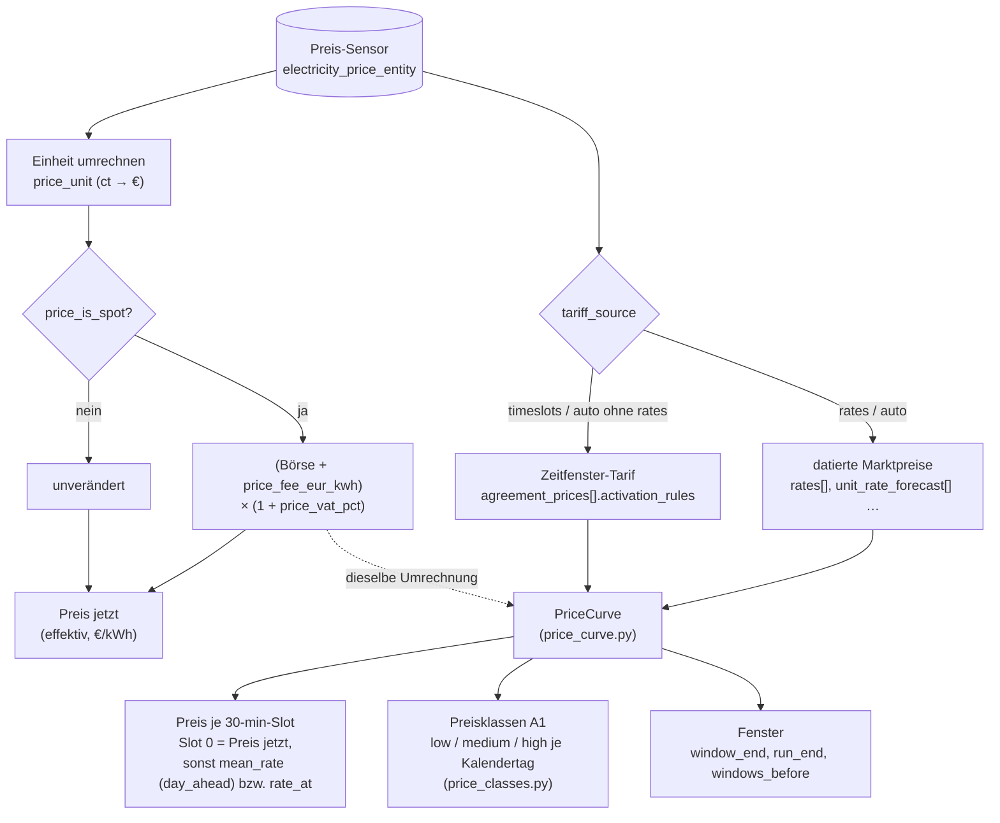
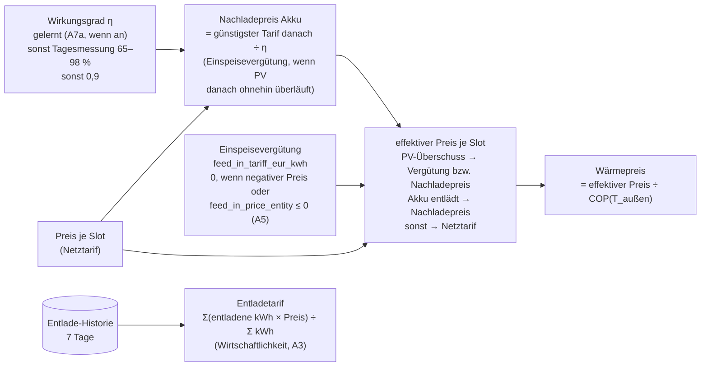
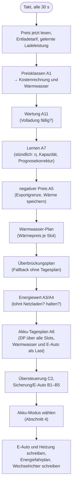
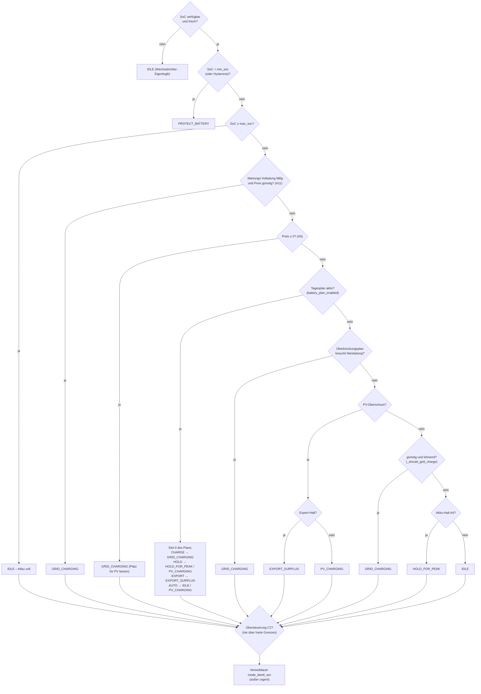

# Preise und Entscheidungen der Verbraucher

Diese Seite zeigt, wie miniEMS aus dem Preis-Sensor die Preise bildet, mit denen Akku,
Warmwasser, Heizung und E-Auto entscheiden. Sie ist die Übersicht. Die Einzelheiten stehen
auf den verlinkten Seiten. Stand: v4.2.3.

## 1. Vom Preis-Sensor zur Preiskurve

Grundlage ist der Preis-Sensor (`electricity_price_entity`). Daraus entstehen zwei Dinge:
der **Preis jetzt** und die **Preiskurve** für die kommenden Stunden.

- **Fehlt die Preiskurve** (kein Tarifkalender, keine Marktpreise), gibt es keine Planung. Dann
  entscheiden nur noch der Preis jetzt und die festen Schwellen (`cheap_rate_threshold_eur`,
  `medium_rate_threshold_eur`).
- **Preisklassen (A1):** `low` = die `price_cheap_hours` günstigsten Stunden des Tages,
  `high` = deutlich über dem Median. Ist die Spanne des Tages kleiner als
  `price_flat_spread_eur`, ist nichts `low`, und es wird nicht optimiert. Einzelheiten in
  `price_classes.py`.

## 2. Abgeleitete Preise

Aus Preiskurve, Akkustand und Prognosen leitet miniEMS weitere Preise ab. Sie geben an, was
eine kWh **in einem bestimmten Slot aus einer bestimmten Quelle** wirklich kostet.

| Abgeleiteter Preis | Wer nutzt ihn | Code |
|---|---|---|
| Wirkungsgrad η | Tagesplan, Überbrückungsplan, Warmwasser, Wirtschaftlichkeitsprüfung | `EMSController._round_trip_eta()`, `_measured_eta()` |
| Nachladepreis Akku | Warmwasser (`battery_projection`), Energiewert (A3) | `battery_projection.py`, `energy_value.py` |
| Effektiver Preis je Slot | Warmwasser, E-Auto | `hot_water_planner._slot_price`, `energy_task.effective_price` |
| Wärmepreis (÷ COP) | Warmwasser, Heizung | `hot_water_planner.py`, `heating_controller.py` |
| Entladetarif (Historie) | Wirtschaftlichkeitsprüfung Netzladen | `CostOptimizer.avg_discharge_tariff_eur_kwh()` |
| Einspeisevergütung | Tagesplan (Export), Warmwasser, E-Auto, Export-Halt | `_export_unpaid()` |

## 3. Reihenfolge in einem Takt

Alle 30 Sekunden rechnet `EMSController.update()` in dieser Reihenfolge. Spätere Schritte
nutzen die Ergebnisse der früheren.

## 4. Akku: Wahl des Modus

`_determine_mode()` → `_decide()` → Übersteuerung → Verweildauer. Die erste zutreffende Regel
gewinnt.

- **Der Tagesplan** (`battery_plan.py`) bewertet jeden Slot mit: Import × Slotpreis −
  bezahlter Export × Vergütung + Verschleiß × Entladung + Wechselkosten. Die Energie am Ende
  des Horizonts zählt mit dem Restwert (Perzentil der Preise × η). Details:
  [Netzladen-Entscheidung](netzladen-entscheidung.md).
- **Wirtschaftlichkeit ohne Tagesplan:** Netzladen nur, wenn η × Entladetarif − Preis jetzt >
  `grid_charge_min_margin_eur_kwh` (bzw. A3 über den Energiewert).

## 5. Verbraucher im Überblick

| Verbraucher | Entscheidet nach | Planer | Ausgeführt über |
|---|---|---|---|
| Akku | Slotpreise, η, Einspeisevergütung, Restwert | Tagesplan (DP), Fallback Überbrückungsplan | Lade-/Entladestrom, Netzlade-Schalter |
| Warmwasser | Wärmepreis je Slot (effektiver Preis ÷ COP), Verlust, Zapfprofil | gierig über ganze Ladungen | Boiler-Sollwert |
| E-Auto | effektiver Preis je Slot (PV-Anteil zur Vergütung), Abfahrt, Ziel-SoC | `ev_planner` über `energy_task` | Wallbox-Strom, Freigabe |
| Heizung | Preisklasse A1, Vorladen vor `high`, COP-Prüfung | Regeln (B6), Raummodell (B7) | Vorlauf-Offset |

Warmwasser und E-Auto gehen als **geplante Last** in den Tagesplan des Akkus ein
(`_with_planned_loads`). Der Akku sieht also, was die anderen vorhaben. Umgekehrt lesen
Warmwasser und E-Auto die Akku-Herkunft aus einer eigenen, einfachen Vorwärtsrechnung
(`battery_projection`), nicht aus dem Tagesplan.

## Siehe auch

- [Netzladen-Entscheidung](netzladen-entscheidung.md): Überbrückungsplan, Verbrauchsmodell
- [Warmwasser-Steuerung](warmwasser-steuerung.md): Wärmepreis und Fahrplan im Detail
- [Energiefahrplan](energiefahrplan.md): Netzladefenster und gelernte Ladeleistung
- [Berechnungen](calculations.md): Formeln und Schwellwerte
