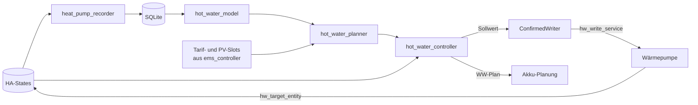
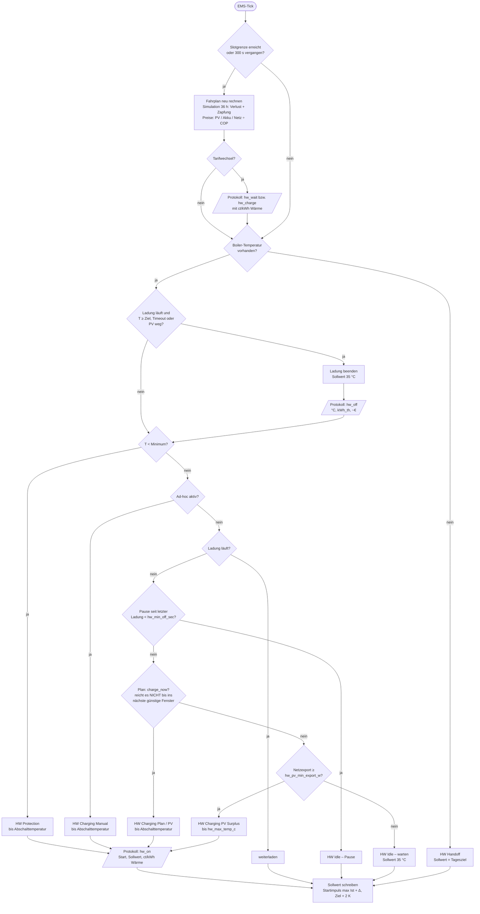

# Warmwasser-Steuerung (technisch)

Diese Seite beschreibt Aufbau, Datenfluss und Entscheidungslogik der WW-Steuerung
ab v3.5.0. Für Bedienung und Einrichtung siehe [Warmwasser (Benutzer)](../user/warmwasser.md).
Planungsstand und offene Punkte stehen in der Roadmap `docs/roadmap/v3.4-warmwasser.md`.

Grundprinzip wie beim Netzladen des Akkus: **fail safe**. Fehlt die Boiler-Temperatur,
gibt miniEMS die Regelung an die Wärmepumpe zurück (Sollwert = Tagesziel). Es wird
nichts geschrieben, solange `hw_control_enabled` aus ist oder
`hw_control_simulation` an.

---

## Module

| Datei | Aufgabe |
|---|---|
| `heat_pump_recorder.py` | Datensammlung pro Tick: COP-Filter, Stundenaggregate, Verlust-Segmente, Zapfungen. Steuert nichts. |
| `hot_water_model.py` | Lernt COP(T_außen), Verlust, Heizleistung und Zapfprofil aus 60 Tagen Historie. Neu-Fit höchstens stündlich. |
| `hot_water_planner.py` | Reiner Rechenkern ohne I/O: 36-h-Fahrplan in 30-min-Slots, ganze Ladungen bis Abschalttemperatur, Kosten je kWh Wärme, Entscheidung „jetzt laden / warten“ |
| `battery_projection.py` | Reiner Rechenkern: Akkustand je Slot (voll, hat Energie, Netzladefenster) und Nachladepreis |
| `hot_water_controller.py` | Entscheidung je Tick, Sollwert-Abbildung, Schreiben mit Bestätigung, Ad-hoc |
| `ha_service.py` | `ConfirmedWriter`: dieselbe Sende- und Bestätigungslogik wie beim Wechselrichter |
| `ems_controller.py` | Ruft Recorder und Controller pro Tick auf. Koppelt den WW-Plan an die Akku-Planung. |
| `web_server.py` | `/heatpump`, `/api/hot_water/*`, `/api/control_mode`, WW-Teil von `/api/status` |
| `templates/heatpump.html` | Tab „Wärmepumpe“ |



---

## 1. Datensammlung (`heat_pump_recorder.py`)

### COP-Filter

Verworfen werden:

- die ersten `hp_cop_settle_sec` (300 s) eines Laufs. Ein Lauf beginnt, wenn der COP
  von 0 auf > 0 springt oder der Betriebsmodus während des Laufs wechselt;
- Werte außerhalb 0,5…10 (Abtauen, Ausreißer).

### Tabellen

| Tabelle | Inhalt |
|---|---|
| `heat_pump_hourly` | PK (Stunde, Modus-Code). `ticks`, `cop_ticks`, `cop_avg` (nur gefilterte Werte), `outdoor_temp_c`, `boil_temp_c`, `heat_pump_kwh`. Modus −1 = nicht verfügbar. |
| `hot_water_loss_segments` | Standby-Segmente in K/h. Gemessen wird nur, wenn Modus ≠ `hp_mode_hot_water_code` und Request ≠ `hp_request_hot_water_code`. Mindestdauer 1 h. Verworfen werden Segmente mit Temperaturanstieg und Segmente mit einer Lücke > 3 Tick-Intervalle. |
| `hot_water_draws` | Zapfungen: Abfall ≥ `hw_draw_drop_k` binnen 10 min. „Davor“ = Maximum im Fenster. Die Zapfung endet, wenn 10 min lang kein neues Minimum kommt. |

Bewertet wird das ganze Standby-Segment, nicht Tick-Deltas: Bei 0,5 K Sensorauflösung
sagt ein 30-s-Delta nichts aus.

---

## 2. Modell (`hot_water_model.py`)

| Größe | Verfahren | Fallback |
|---|---|---|
| **COP(T_außen)** | Gewichtete lineare Regression `COP = a + b·T` über WW-Stunden mit ≥ 10 gefilterten Ticks, Gewicht = Laufzeit. Der Startwert geht als zwei Pseudo-Punkte (zusammen 3 h) ein und wird nie gespeichert. Begrenzt auf 1,5…8. | `hw_cop_prior` bei `hw_cop_prior_temp_c`, Steigung 0,08/K. Unter 6 h echter Laufzeit gilt `cop_source = prior`. |
| **Verlust** | k = Median(K/h ÷ (T_Boiler − 20 °C)) aus ≥ 3 Segmenten | 0,25 K/h bei 30 K über Raumtemperatur |
| **Heizleistung thermisch** | Median(kWh_el ÷ Laufzeit × COP) der WW-Stunden | `hw_heat_power_kw` |
| **Zapfprofil** | Ø Abfall in K je (Werktag/Wochenende, Stunde), Historie 28 Tage | ab 7 Tagen Daten, sonst keine Zapfung |
| **Pauschaler WW-Anteil** | Ø WW-Strom je Stunde (kWh) | – |

Der Verlust ist proportional zu T_Boiler − 20 °C. Ein heißerer Speicher verliert also
schneller.

---

## 3. Fahrplan (`hot_water_planner.py`)

**Horizont:** 36 h in 30-min-Slots (`PLAN_HORIZON_H`, `PLAN_SLOT_MIN`). Die Slots
(Tarif, PV, Last) kommen aus der Akku-Planung. Ohne Tarifkalender gilt ein
einheitlicher Preis, dann wird möglichst spät geladen. Neu berechnet wird alle 300 s
(`HW_PLAN_RECOMPUTE_SEC`) **und an jeder Slotgrenze**. Damit ist jeder Tarifwechsel
ein Entscheidungszeitpunkt, und eine für den nächsten Slot geplante Ladung startet
pünktlich.

**Ganze Ladungen:** Geheizt wird nur in ganzen Ladungen. Eine Ladung beginnt in einem
Slot und läuft mit der gelernten Heizleistung, bis die Abschalttemperatur
`hw_morning_target_c` erreicht ist. Genau so arbeitet auch der Controller.

```text
Ladung aktiv:  T += min(Heizleistung · h · K_pro_kWh_th, T_Abschalt − T)
jeder Slot:    T −= k · (T − 20 °C) · h  +  Zapfung(Slot)
Start nur, wenn T < T_Abschalt − 0,5 K
```

Umrechnung: 1 kWh_th = 1000 ÷ (1,163 Wh/(l·K) · `hw_volume_l`) K. Bei 200 l und 4 kW
dauern 6 K etwa 21 min.

**Anforderungen:**

- jeder Slot ≥ Tagesziel = max(`hw_day_target_c`, `hot_water_min_temp_c`);
- an Werktagen beim Slot, der `hw_morning_time` enthält: ≥ Abschalttemperatur − 1 K
  (`_MORNING_SLACK_K`). Läge die Anforderung genau auf der Obergrenze, wäre sie nach
  einem Slot Standby-Verlust nie erfüllbar. Werktag heute aus `hw_workday_entity`,
  sonst Mo–Fr.

**Effektiver Strompreis je Slot** (`_slot_price`):

| Anteil des WW-Stroms | Bedingung | Preis je kWh_el | Quelle |
|---|---|---|---|
| aus PV-Überschuss (PV − Lastprognose) | Akku voll oder unbekannt | Einspeisevergütung | `pv` |
| aus PV-Überschuss | Akku nicht voll | max(Einspeisevergütung, Nachladepreis) | `pv` |
| Rest | Akku hat Energie, darf entladen, Nachladepreis < Tarif | Nachladepreis | `battery` |
| Rest | sonst (Akku leer, Netzladefenster, kein SoC) | Netztarif des Slots | `grid` |

Kosten je kWh Wärme im Slot = Preis ÷ COP(T_außen des Slots).

**Akku-Prognose** (`battery_projection.project_battery`): einfache Vorwärtssimulation
ab dem aktuellen nutzbaren Akkuinhalt.
- Außerhalb von Netzladefenstern deckt der Akku PV − Last, begrenzt auf [0, Kapazität].
- Im Netzladefenster (Tarif ≤ Horizont-Minimum + 0,5 ct, nur mit
  `battery_control_enabled`) entlädt er nicht. Wie viel dort aus dem Netz geladen wird,
  ist nicht modelliert. Das ist konservativ: Danach erscheint der Akku leerer, also wird
  öfter mit dem Netztarif gerechnet.
- **Nachladepreis** je Slot, also was eine jetzt entnommene Akku-kWh wirklich kostet:
  - **Einspeisevergütung**, wenn danach mindestens 0,5 kWh PV „überlaufen“ (Akku voll,
    Überschuss wird eingespeist), ohne dass der Akku vorher leer wird. Die entnommene
    kWh wird dann einfach später nicht eingespeist (`refilled_by_pv`). Typisch: sonniger
    Tag, Akku morgens halb voll.
  - sonst **günstigster Tarif danach ÷ η** (η = `cost_optimizer.today_efficiency()`,
    ersatzweise 0,9): Die kWh muss aus dem Netz zurückgekauft werden.
- Der Akku zählt nur mit SoC und Lastprognose. Die Last der WW-Ladung selbst wird nicht
  in die Akku-Prognose zurückgekoppelt.
- Die Lastprognose wird vor der WW-Planung aufgefrischt (`ems_controller._update_hot_water`),
  nicht erst in der Brückenplanung danach. Sonst sähe der erste Plan nach einem Start
  weder PV-Überschuss noch Akku und rechnete nur mit dem Netztarif.
- **Diagnose:** `/api/status` → `hot_water.plan.slots` zeigt für die ersten 48 Slots
  Tarif, PV-Überschuss, PV-Anteil, Akku-Flags, Nachladepreis, effektiven Preis, Quelle,
  COP und Kosten je kWh Wärme.

**Greedy über ganze Ladungen:**

1. Ohne Heizen simulieren. Die erste Verletzung ist der Bedarfszeitpunkt
   (`need_at`).
2. Jeder Slot `j ≤ v` ist ein Kandidat für einen Ladungsstart. Gültig ist er nur, wenn
   seine Ladung (bis Abschalttemperatur) die Verletzung `v` behebt.
3. Bewertung: `score = Kosten je kWh_th der Ladung ÷ Haltefaktor(Ladungsende → v)`,
   Haltefaktor = Π (1 − k · h). Früheres Laden zahlt den zusätzlichen Verlust mit.
4. **„Jetzt“ (Slot 0) gewinnt**, wenn sein Score höchstens `hw_decision_tolerance_pct`
   (5 %) über dem besten liegt. Sonst gewinnt der günstigste Kandidat, bei Gleichstand
   der spätere (weniger Verlust).
5. Ladung übernehmen, neu simulieren und mit Schritt 1 weitermachen, bis keine
   Anforderung mehr verletzt ist (höchstens 48 Ladungen). Gibt es für eine Verletzung
   keinen gültigen Kandidaten, gilt der Plan als `feasible = false`, mit Begründung.

Ergebnis:
- je Ladung ein **Fenster** mit Start, Ende, Starttemperatur (`from_c`), Ziel (`goal_c`),
  Wärme, Strom, Kosten, mittlerem COP, Quelle und **Kosten je kWh Wärme**
  (`cost_th_eur_kwh`);
- dazu `charge_now`, `need_at`, `now_cost_th_eur_kwh` (eine Ladung jetzt) und der Text
  `decision`, z. B. `wait – enough until 02:30 (45.9 °C then); now 7.5 ct/kWh_th, then
  2.5 ct/kWh_th (grid, COP 4.0)`.

---

## 4. Entscheidung (`hot_water_controller.py`)

Pro Tick in dieser Reihenfolge. Zuerst prüft `_check_stop` eine laufende Ladung.
„Ziel“ ist immer die **Abschalttemperatur** (gemessene Ist-Temperatur), nicht der
geschriebene Sollwert.

| # | Bedingung | Modus | Ziel (Abschalten bei T ≥) |
|---|---|---|---|
| 0 | Laufende Ladung: T ≥ Ziel, > 3 h, oder **spontane** PV-Ladung (Regel 7) bei Netzbezug ohne Plan-Fenster. Eine vom Plan gestartete Ladung läuft immer bis zum Ziel, auch wenn ihre Quelle PV war. | Ladung endet → Sollwert 35 °C | – |
| 1 | Boiler-Temperatur fehlt | `HW Handoff` | – (Sollwert = Tagesziel) |
| 2 | T < `hot_water_min_temp_c` | `HW Protection` | `hw_morning_target_c` |
| 3 | Ad-hoc aktiv | `HW Charging (Manual)` | `hw_morning_target_c` |
| 4 | Ladung läuft | wie gestartet | unverändert |
| 5 | Ladung vor < `hw_min_off_sec` beendet | `HW Idle` | – |
| 6 | Plan sagt `charge_now` (Ladung beginnt im aktuellen Slot) und T < Ziel − 0,5 K | `HW Charging (Plan)` / `(PV Surplus)` | `hw_morning_target_c` |
| 7 | Netzexport ≥ `hw_pv_min_export_w` und T < `hw_max_temp_c` − 1 K | `HW Charging (PV Surplus)` | `hw_max_temp_c` |
| 8 | sonst | `HW Idle`, Begründung = `plan.decision` | – |

Ad-hoc bei T ≥ Abschalttemperatur wird nicht gestartet. Die API antwortet dann mit
`info: "already at shut-off temperature"`.

### Ablauf der Entscheidung



Die Frage „reicht es bis ins nächste günstige Fenster?“ beantwortet der Planer:
`charge_now` ist genau dann wahr, wenn eine Ladung jetzt höchstens 5 % teurer je kWh
Wärme ist als die beste spätere Ladung, die den Bedarf noch rechtzeitig deckt. Das
schließt den Fall ein, dass es keine spätere Ladung mehr rechtzeitig schafft.

### Meldungen im Ereignisprotokoll

Alle WW-Einträge haben `entry_type = "hw_decision"`. Die Spalte `price_eur_kwh`
enthält die **angenommenen Kosten je kWh Wärme**, die Protokoll-Seite zeigt sie als
„ct/kWh Wärme“.

| `state` | Wann | `reason` (Beispiel) | Kosten |
|---|---|---|---|
| `hw_wait` | nur beim Tarifwechsel, warten (die 5-min-Neuberechnungen werden nicht protokolliert) | `tariff change 30.1 ct: wait – enough until 02:30 (45.9 °C then); now 7.5 ct/kWh_th, then 2.5 ct/kWh_th (grid, COP 4.0)` | Ladung jetzt |
| `hw_charge` | Tarifwechsel, Plan will laden, aber es startet keine Ladung (z. B. Pause) | `tariff change 12.0 ct: charge now until 51 °C – …` | Ladung jetzt |
| `hw_on` | Start jeder Ladung (Plan, PV, Schutz, Ad-hoc) | `start HW Charging (Plan): 46.0 → 51 °C, setpoint 56.0 °C – plan: charge now …` | Ladung |
| `hw_off` | Ende, Abbruch oder Timeout einer Ladung | `goal 51 °C reached: 46.0 → 51.0 °C in 23 min, 1.16 kWh_th, ~0.03 €` | Ladung |
| `hw_off` | sonstiger Moduswechsel ohne Ladung (z. B. Handoff) | `boiler temperature unavailable – heat pump controls itself` | – |
| `draw_start` | Zapfung erkannt (Abfall ≥ `hw_draw_drop_k` in 10 min) | `hot-water draw detected since 09:26: 48.4 → 46.8 °C (−1.6 K so far)` | – |
| `draw_end` | Zapfung abgeschlossen und gespeichert (10 min kein neuer Tiefstwert) | `hot-water draw finished: 09:26, 48.4 → 45.3 °C (−3.1 K) over 12 min` | – |

Die Zapf-Meldungen kommen aus `heat_pump_recorder.pop_events()`, das
`ems_controller._log_draw_event` jeden Tick abholt. Eine laufende Zapfung steht sofort
in `/api/status` → `heat_pump.draw_active` (`since`, `temp_before_c`, `temp_now_c`,
`drop_k`). Der Tab „Wärmepumpe“ zeigt sie unter der Boiler-Temperatur und als erste Zeile
der Zapf-Tabelle, bevor sie gespeichert ist.

Bei einer gestarteten Ladung ersetzt der `hw_on`-Eintrag den `hw_charge`-Eintrag
desselben Ticks. Kosten einer spontanen PV-Ladung: Einspeisevergütung ÷ COP.

### Sollwert-Abbildung

Der Sollwert ist ein **Startimpuls**, damit die Lambda in den WW-Modus wechselt. Er wird
nie als Abschaltkriterium genutzt.

| Situation | Sollwert |
|---|---|
| Ladung starten (`_impulse_c`) | min(65, max(T_Start + Δ, Ziel + 2 K)), beim Start festgelegt. Δ = `hw_adhoc_delta_k` bei Ad-hoc, sonst `hw_boost_delta_k`. Die Untergrenze Ziel + 2 K (`_PSEUDO_MARGIN_K`) verhindert, dass die WP vor miniEMS über ihre eigene Hysterese abschaltet. |
| Keine Ladung (Ziel erreicht, Abbruch, Timeout, Pause, Idle) | fest `hw_idle_setpoint_c` (35 °C). Er muss ≥ 5 K unter `hot_water_min_temp_c` liegen, sonst senkt `_validate` ihn auf Min − 5 K. Weit unter der Haltetemperatur, damit die WP-eigene Hysterese nie selbst eine Ladung startet. Das Minimum sichert Regel 2 (Schutzladung). |
| Handoff, Shutdown, Verlassen von LIVE | Tagesziel |
| Obergrenze | immer 65 °C |

Beispiel mit Abschalttemperatur 51 °C: Ad-hoc bei 47,4 °C → Sollwert 57,4 °C. Die WP
heizt. Bei Ist = 51,0 °C schreibt miniEMS 35 °C. Ob die WP 57,4 °C erreichen könnte,
spielt keine Rolle.

`_validate` hebt `hw_morning_target_c` auf mindestens Tagesziel + 2 K an
(`_HW_SHUTOFF_MIN_GAP_K`), sonst würde jede Ladung sofort enden.

### Schreiben

```text
raw  = round(°C × hw_write_scale)
data = json.loads(hw_write_data.replace("{value}", str(raw)))
→ POST /api/services/<domain>/<service>  (aus hw_write_service)
```

Lambda: `lambda_heat_pumps.write_modbus_register` mit
`{"register_address": 2050, "value": 570}` für 57,0 °C. Gesendet wird nur `data`,
ohne `entity_id`.

Die Bestätigung übernimmt `ConfirmedWriter`:

- Der Wert gilt als bestätigt, wenn `hw_target_entity` innerhalb von ±0,5 K liegt.
- Bis dahin wird nach Ablauf der Bestätigungsfrist erneut gesendet.
- Gleiche Ziele werden nicht doppelt gesendet.
- Ein bestätigter Wert wird jeden Tick nachgeprüft. Meldet die WP später etwas
  anderes, wird die Bestätigung verworfen und neu geschrieben (Warnung im Log). Das
  passiert z. B. nach einem Neustart, wenn HA noch den alten Wert zeigt und erst danach
  den Shutdown-Wert (Tagesziel) des vorherigen Laufs, oder wenn ein anderer Schreiber
  auf dasselbe Register schreibt. In der Simulation gibt es keine Nachprüfung.
- In der Simulation wird nur `[SIM] …` geloggt, und der Kanal gilt sofort als bestätigt.

### Ad-hoc

- `POST /api/hot_water/adhoc {"action":"start"}` liest die Boiler-Temperatur.
  Ziel ist die Abschalttemperatur, der Sollwert-Impuls ist Ist + `hw_adhoc_delta_k`.
  Danach ruft es sofort `_step()` auf (entscheiden, loggen, schreiben) und wartet nicht
  auf den nächsten EMS-Tick.
- `{"action":"cancel"}` beendet die manuelle Ladung und schreibt sofort den
  Halte-Sollwert.
- Timeout nach 2 h (`HW_ADHOC_MAX_SEC`). Die Schutzladung hat Vorrang.

---

## 5. Kopplung an die Akku-Planung

Nur wenn die Steuerung **live** läuft (`couples`). In der Simulation läuft die WP nach
ihrem eigenen Zeitplan, und die gelernte Last bleibt korrekt.

- **Überbrückungsplan:** Last je Slot − pauschaler WW-Anteil + geplanter WW-Strom
  (`load_delta_kwh`).
- **Energiefahrplan und Netzladen-Fallback:** Das Defizit steigt um den WW-Strom, der
  vor der Deadline aus PV geplant ist (`planned_pv_kwh_before`).

---

## 6. Betriebsart umschalten (`/api/control_mode`)

Simulation, Batteriesteuerung und WP-Steuerung lassen sich zur Laufzeit umschalten,
ohne Neustart:

1. Wechselt ein Teil von LIVE nach Simulation oder aus, ruft miniEMS zuerst dessen
   `restore_safe_defaults()` auf. Das geschieht, solange die alten Flags noch echte
   Writes erlauben. Für die WP heißt das: Sollwert = Tagesziel.
2. Danach setzt miniEMS die Flags im laufenden `Config`-Objekt. Die Controller lesen
   es bei jedem Tick.
3. `reset_write_state()` auf Wechselrichter und WW-Controller. Simulierte Writes gelten
   als bestätigt, ohne gesendet worden zu sein. Ohne Reset würde nach Simulation → LIVE
   nichts geschrieben.
4. Die Flags werden atomar in `config.json` geschrieben (Temp-Datei, `fsync`,
   `os.replace`).

**Restart-Sicherheit:** `battery_control_enabled`, `battery_control_simulation`,
`hw_control_enabled` und `hw_control_simulation` stehen in
`config_loader.CONTROL_MODE_KEYS`. Beim Start gilt für sie nur `config.json`.
Abweichende Werte in `options.json` werden ignoriert und als Warnung geloggt.
So kann eine veraltete `options.json` nie unbemerkt auf LIVE zurückschalten.

---

## 7. API

| Endpunkt | Zweck |
|---|---|
| `GET /heatpump` | Tab „Wärmepumpe“ |
| `GET /api/status` → `hot_water` | Wird bei jeder Anfrage live aus dem Controller gelesen, nicht aus dem Tick-Snapshot. Enthält `mode`, `reason`, `setpoint` (`target_c`, `raw_value`, `read_back_c`, `confirmed`), `charge`, `adhoc`, `learned`, `plan`, `couples_battery_plan`. |
| `GET /api/status` → `heat_pump` | Recorder-Status: `cop_raw`, `cop_filtered`, `mode`, `request_type`, `boil_temp_c`, `heating_hot_water`, `segment_age_h`, `segment_k_per_h` |
| `POST /api/hot_water/adhoc` | `{"action": "start" \| "cancel"}` → Ad-hoc-Status (`active`, `target_c` = Abschalttemperatur, `setpoint_c` = Startimpuls, `delta_k`, `since`, `elapsed_sec`, `max_sec`, `simulation`, `control_enabled`, ggf. `info`). 409 ohne `boil_temp_entity`. |
| `GET /api/hot_water/history` | `hours` (letzte 48 h), `segments`, `draws` |
| `GET /api/control_mode` | `simulation`, `simulation_mixed`, `battery_control`, `hw_control`, `battery_live`, `hw_live` |
| `POST /api/control_mode` | Teilobjekt mit `simulation`, `battery_control`, `hw_control`. Antwort wie bei GET. 400 bei leerem Objekt. |

---

## 8. Konstanten (`const.py`)

| Konstante | Wert | Bedeutung |
|---|---|---|
| `HW_PLAN_RECOMPUTE_SEC` | 300 | Fahrplan neu berechnen |
| `HW_CHARGE_MAX_SEC` | 3 h | Maximale Dauer einer Ladung |
| `HW_ADHOC_MAX_SEC` | 2 h | Timeout der Ad-hoc-Ladung |
| `HW_MODEL_REFIT_SEC` / `HW_MODEL_LOOKBACK_DAYS` | 3600 / 60 | Neu-Fit des Modells |
| `HW_COP_MIN_LEARNED_H` | 6 | Ab hier gilt der COP als gelernt |
| `HW_COP_CLAMP` | 1,5…8 | Grenzen des gelernten COP |
| `HW_LOSS_MIN_SEGMENTS` | 3 | Mindestanzahl Segmente für den gelernten Verlust |
| `HW_DRAW_MIN_DAYS` | 7 | Mindestdauer der Historie für das Zapfprofil |
| `HW_ROOM_TEMP_C` | 20 | Raumtemperatur im Verlustmodell |
| `HW_WH_PER_L_K` | 1,163 | Wärmekapazität Wasser |
